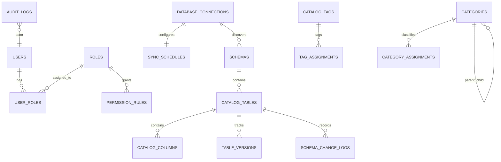

# Data Model & Schema Specification (Phase 1)

**Feature**: Enterprise Data Catalog (Phase 1 - Core Platform)  
**Branch**: `001-core-platform`  
**Date**: 2026-11-09  

---

## 1. Relational Entity-Relationship Overview



---

## 2. Complete PostgreSQL 16 Production DDL

```sql
-- ============================================================================
-- Enterprise Data Catalog - PostgreSQL 16 DDL
-- Target Volume: 800 Databases, 160,000 Tables, 5,000,000 Columns
-- ============================================================================

-- Extensions
CREATE EXTENSION IF NOT EXISTS "uuid-ossp";
CREATE EXTENSION IF NOT EXISTS "pg_trgm";
CREATE EXTENSION IF NOT EXISTS "btree_gist";

-- ENUM Types
CREATE TYPE user_status_enum AS ENUM ('ACTIVE', 'SUSPENDED', 'DEACTIVATED');
CREATE TYPE permission_action_enum AS ENUM (
    'VIEW_METADATA',
    'EDIT_DESCRIPTION',
    'MANAGE_TAGS',
    'MANAGE_CONNECTIONS',
    'VIEW_AUDIT_LOGS',
    'EXPORT_REPORTS'
);
CREATE TYPE permission_effect_enum AS ENUM ('ALLOW', 'DENY');
CREATE TYPE resource_type_enum AS ENUM ('GLOBAL', 'DATABASE', 'SCHEMA', 'TABLE', 'COLUMN', 'CATEGORY');
CREATE TYPE database_engine_enum AS ENUM ('POSTGRESQL', 'MSSQL', 'ORACLE', 'MYSQL', 'CLICKHOUSE');
CREATE TYPE table_type_enum AS ENUM ('TABLE', 'VIEW', 'MATERIALIZED_VIEW', 'EXTERNAL_TABLE');
CREATE TYPE lifecycle_status_enum AS ENUM ('ACTIVE', 'DEPRECATED', 'DELETED');
CREATE TYPE classification_level_enum AS ENUM ('PUBLIC', 'INTERNAL', 'CONFIDENTIAL', 'PII');
CREATE TYPE schema_change_type_enum AS ENUM (
    'COLUMN_ADDED',
    'COLUMN_DROPPED',
    'TYPE_CHANGED',
    'NULLABILITY_CHANGED',
    'DESCRIPTION_UPDATED',
    'TAG_ASSIGNED',
    'TAG_REMOVED'
);
CREATE TYPE entity_type_enum AS ENUM ('DATABASE', 'SCHEMA', 'TABLE', 'COLUMN');

-- ----------------------------------------------------------------------------
-- 1. Identity & RBAC Tables
-- ----------------------------------------------------------------------------
CREATE TABLE users (
    id UUID PRIMARY KEY DEFAULT gen_random_uuid(),
    username VARCHAR(100) NOT NULL UNIQUE,
    email VARCHAR(255) NOT NULL UNIQUE,
    hashed_password VARCHAR(255) NOT NULL,
    full_name VARCHAR(255) NOT NULL,
    status user_status_enum NOT NULL DEFAULT 'ACTIVE',
    is_superadmin BOOLEAN NOT NULL DEFAULT FALSE,
    created_at TIMESTAMPTZ NOT NULL DEFAULT clock_timestamp(),
    updated_at TIMESTAMPTZ NOT NULL DEFAULT clock_timestamp()
);

CREATE TABLE roles (
    id UUID PRIMARY KEY DEFAULT gen_random_uuid(),
    name VARCHAR(100) NOT NULL UNIQUE,
    description TEXT,
    is_system_role BOOLEAN NOT NULL DEFAULT FALSE,
    created_at TIMESTAMPTZ NOT NULL DEFAULT clock_timestamp()
);

CREATE TABLE user_roles (
    user_id UUID NOT NULL REFERENCES users(id) ON DELETE CASCADE,
    role_id UUID NOT NULL REFERENCES roles(id) ON DELETE CASCADE,
    assigned_at TIMESTAMPTZ NOT NULL DEFAULT clock_timestamp(),
    assigned_by UUID REFERENCES users(id) ON DELETE SET NULL,
    PRIMARY KEY (user_id, role_id)
);

CREATE TABLE permission_rules (
    id UUID PRIMARY KEY DEFAULT gen_random_uuid(),
    role_id UUID NOT NULL REFERENCES roles(id) ON DELETE CASCADE,
    resource_type resource_type_enum NOT NULL,
    resource_id UUID NULL, -- NULL denotes wildcard/all for that resource_type
    action permission_action_enum NOT NULL,
    effect permission_effect_enum NOT NULL DEFAULT 'ALLOW',
    created_at TIMESTAMPTZ NOT NULL DEFAULT clock_timestamp()
);

-- Hierarchical Business Categories
CREATE TABLE categories (
    id UUID PRIMARY KEY DEFAULT gen_random_uuid(),
    name VARCHAR(200) NOT NULL,
    description TEXT,
    parent_id UUID REFERENCES categories(id) ON DELETE CASCADE,
    created_at TIMESTAMPTZ NOT NULL DEFAULT clock_timestamp()
);

CREATE TABLE category_assignments (
    id UUID PRIMARY KEY DEFAULT gen_random_uuid(),
    category_id UUID NOT NULL REFERENCES categories(id) ON DELETE CASCADE,
    entity_type entity_type_enum NOT NULL,
    entity_id UUID NOT NULL,
    created_at TIMESTAMPTZ NOT NULL DEFAULT clock_timestamp(),
    CONSTRAINT uq_category_assignment UNIQUE (category_id, entity_type, entity_id)
);

-- ----------------------------------------------------------------------------
-- 2. Database Connections & Sync Schedules
-- ----------------------------------------------------------------------------
CREATE TABLE database_connections (
    id UUID PRIMARY KEY DEFAULT gen_random_uuid(),
    name VARCHAR(200) NOT NULL UNIQUE,
    engine_type database_engine_enum NOT NULL,
    host VARCHAR(255) NOT NULL,
    port INTEGER NOT NULL,
    database_name VARCHAR(255) NOT NULL,
    default_schema VARCHAR(100),
    owner VARCHAR(255) NOT NULL,
    kek_version INTEGER NOT NULL DEFAULT 1,
    encrypted_dek BYTEA NOT NULL,             -- 12-byte IV + 32-byte encrypted DEK + 16-byte tag
    encrypted_credentials BYTEA NOT NULL,     -- 12-byte IV + encrypted JSON credentials payload + 16-byte tag
    custom_params JSONB NOT NULL DEFAULT '{}'::jsonb,
    is_active BOOLEAN NOT NULL DEFAULT TRUE,
    created_at TIMESTAMPTZ NOT NULL DEFAULT clock_timestamp(),
    updated_at TIMESTAMPTZ NOT NULL DEFAULT clock_timestamp()
);

CREATE TABLE sync_schedules (
    id UUID PRIMARY KEY DEFAULT gen_random_uuid(),
    connection_id UUID NOT NULL UNIQUE REFERENCES database_connections(id) ON DELETE CASCADE,
    cron_expression VARCHAR(100) NOT NULL,
    is_enabled BOOLEAN NOT NULL DEFAULT TRUE,
    last_run_at TIMESTAMPTZ,
    last_run_status VARCHAR(50),
    last_run_message TEXT,
    next_run_at TIMESTAMPTZ,
    created_at TIMESTAMPTZ NOT NULL DEFAULT clock_timestamp(),
    updated_at TIMESTAMPTZ NOT NULL DEFAULT clock_timestamp()
);

-- ----------------------------------------------------------------------------
-- 3. Core Metadata Catalog Hierarchy
-- ----------------------------------------------------------------------------
CREATE TABLE schemas (
    id UUID PRIMARY KEY DEFAULT gen_random_uuid(),
    connection_id UUID NOT NULL REFERENCES database_connections(id) ON DELETE CASCADE,
    name VARCHAR(255) NOT NULL,
    description TEXT,
    owner VARCHAR(255),
    status lifecycle_status_enum NOT NULL DEFAULT 'ACTIVE',
    created_at TIMESTAMPTZ NOT NULL DEFAULT clock_timestamp(),
    updated_at TIMESTAMPTZ NOT NULL DEFAULT clock_timestamp(),
    CONSTRAINT uq_connection_schema UNIQUE (connection_id, name)
);

CREATE TABLE catalog_tables (
    id UUID PRIMARY KEY DEFAULT gen_random_uuid(),
    schema_id UUID NOT NULL REFERENCES schemas(id) ON DELETE CASCADE,
    name VARCHAR(255) NOT NULL,
    table_type table_type_enum NOT NULL DEFAULT 'TABLE',
    row_count_estimate BIGINT NOT NULL DEFAULT 0,
    size_bytes BIGINT NOT NULL DEFAULT 0,
    source_description TEXT,                 -- Synced from source database comments
    approved_description TEXT,               -- Curated and approved in catalog UI
    effective_description TEXT GENERATED ALWAYS AS (
        COALESCE(NULLIF(source_description, ''), approved_description)
    ) STORED,
    owner VARCHAR(255),
    status lifecycle_status_enum NOT NULL DEFAULT 'ACTIVE',
    custom_properties JSONB NOT NULL DEFAULT '{}'::jsonb,
    search_vector tsvector GENERATED ALWAYS AS (
        to_tsvector('english',
            coalesce(name, '') || ' ' ||
            coalesce(source_description, '') || ' ' ||
            coalesce(approved_description, '') || ' ' ||
            coalesce(owner, '')
        )
    ) STORED,
    created_at TIMESTAMPTZ NOT NULL DEFAULT clock_timestamp(),
    updated_at TIMESTAMPTZ NOT NULL DEFAULT clock_timestamp(),
    CONSTRAINT uq_schema_table UNIQUE (schema_id, name)
);

CREATE TABLE catalog_columns (
    id UUID PRIMARY KEY DEFAULT gen_random_uuid(),
    table_id UUID NOT NULL REFERENCES catalog_tables(id) ON DELETE CASCADE,
    name VARCHAR(255) NOT NULL,
    ordinal_position INTEGER NOT NULL,
    data_type VARCHAR(100) NOT NULL,
    raw_data_type VARCHAR(255) NOT NULL,
    is_nullable BOOLEAN NOT NULL DEFAULT TRUE,
    is_primary_key BOOLEAN NOT NULL DEFAULT FALSE,
    is_foreign_key BOOLEAN NOT NULL DEFAULT FALSE,
    default_value TEXT,
    source_description TEXT,
    approved_description TEXT,
    effective_description TEXT GENERATED ALWAYS AS (
        COALESCE(NULLIF(source_description, ''), approved_description)
    ) STORED,
    classification_level classification_level_enum NOT NULL DEFAULT 'INTERNAL',
    status lifecycle_status_enum NOT NULL DEFAULT 'ACTIVE',
    search_vector tsvector GENERATED ALWAYS AS (
        to_tsvector('english',
            coalesce(name, '') || ' ' ||
            coalesce(data_type, '') || ' ' ||
            coalesce(source_description, '') || ' ' ||
            coalesce(approved_description, '')
        )
    ) STORED,
    created_at TIMESTAMPTZ NOT NULL DEFAULT clock_timestamp(),
    updated_at TIMESTAMPTZ NOT NULL DEFAULT clock_timestamp(),
    CONSTRAINT uq_table_column UNIQUE (table_id, name)
);

-- ----------------------------------------------------------------------------
-- 4. Tagging & Classifications
-- ----------------------------------------------------------------------------
CREATE TABLE tags (
    id UUID PRIMARY KEY DEFAULT gen_random_uuid(),
    name VARCHAR(100) NOT NULL UNIQUE,
    color VARCHAR(7) NOT NULL DEFAULT '#1976D2',
    description TEXT,
    is_governed BOOLEAN NOT NULL DEFAULT FALSE,
    created_at TIMESTAMPTZ NOT NULL DEFAULT clock_timestamp()
);

CREATE TABLE tag_assignments (
    id UUID PRIMARY KEY DEFAULT gen_random_uuid(),
    tag_id UUID NOT NULL REFERENCES tags(id) ON DELETE CASCADE,
    entity_type entity_type_enum NOT NULL,
    entity_id UUID NOT NULL,
    assigned_by UUID REFERENCES users(id) ON DELETE SET NULL,
    assigned_at TIMESTAMPTZ NOT NULL DEFAULT clock_timestamp(),
    CONSTRAINT uq_tag_assignment UNIQUE (tag_id, entity_type, entity_id)
);

-- ----------------------------------------------------------------------------
-- 5. Table History & Schema Versioning
-- ----------------------------------------------------------------------------
CREATE TABLE table_versions (
    id UUID PRIMARY KEY DEFAULT gen_random_uuid(),
    table_id UUID NOT NULL REFERENCES catalog_tables(id) ON DELETE CASCADE,
    version_num INTEGER NOT NULL,
    snapshot_jsonb JSONB NOT NULL,
    created_by UUID REFERENCES users(id) ON DELETE SET NULL,
    created_at TIMESTAMPTZ NOT NULL DEFAULT clock_timestamp(),
    CONSTRAINT uq_table_version UNIQUE (table_id, version_num)
);

CREATE TABLE schema_change_logs (
    id UUID PRIMARY KEY DEFAULT gen_random_uuid(),
    table_id UUID NOT NULL REFERENCES catalog_tables(id) ON DELETE CASCADE,
    version_id UUID REFERENCES table_versions(id) ON DELETE SET NULL,
    change_type schema_change_type_enum NOT NULL,
    column_name VARCHAR(255),
    old_value JSONB,
    new_value JSONB,
    actor_id UUID REFERENCES users(id) ON DELETE SET NULL,
    created_at TIMESTAMPTZ NOT NULL DEFAULT clock_timestamp()
);

-- ----------------------------------------------------------------------------
-- 6. Partitioned Immutable Audit Logs (Month-Partitioned)
-- ----------------------------------------------------------------------------
CREATE TABLE audit_logs (
    id UUID NOT NULL DEFAULT gen_random_uuid(),
    actor_id UUID REFERENCES users(id) ON DELETE SET NULL,
    actor_username VARCHAR(100) NOT NULL,
    ip_address INET,
    user_agent VARCHAR(500),
    action VARCHAR(100) NOT NULL,
    entity_type entity_type_enum NOT NULL,
    entity_id UUID NOT NULL,
    diff_jsonb JSONB NOT NULL DEFAULT '{}'::jsonb,
    created_at TIMESTAMPTZ NOT NULL DEFAULT clock_timestamp(),
    PRIMARY KEY (id, created_at)
) PARTITION BY RANGE (created_at);

-- Initial Monthly Partitions (2026-11 through 2027-04)
CREATE TABLE audit_logs_y2026m11 PARTITION OF audit_logs
    FOR VALUES FROM ('2026-11-01 00:00:00+00') TO ('2026-12-01 00:00:00+00');
CREATE TABLE audit_logs_y2026m12 PARTITION OF audit_logs
    FOR VALUES FROM ('2026-12-01 00:00:00+00') TO ('2027-01-01 00:00:00+00');
CREATE TABLE audit_logs_y2027m01 PARTITION OF audit_logs
    FOR VALUES FROM ('2027-01-01 00:00:00+00') TO ('2027-02-01 00:00:00+00');
CREATE TABLE audit_logs_y2027m02 PARTITION OF audit_logs
    FOR VALUES FROM ('2027-02-01 00:00:00+00') TO ('2027-03-01 00:00:00+00');

-- Enforce Immutability via Rules
CREATE RULE audit_logs_no_update AS ON UPDATE TO audit_logs DO INSTEAD NOTHING;
CREATE RULE audit_logs_no_delete AS ON DELETE TO audit_logs DO INSTEAD NOTHING;

-- ----------------------------------------------------------------------------
-- 7. High-Performance Index Definitions (160k Tables, 5M Columns)
-- ----------------------------------------------------------------------------

-- A. Keyset Navigation & Filtering Indexes (B-Tree)
CREATE INDEX idx_tables_keyset_schema ON catalog_tables (schema_id, name ASC, id ASC)
    WHERE status != 'DELETED';
CREATE INDEX idx_tables_keyset_global ON catalog_tables (name ASC, id ASC)
    WHERE status != 'DELETED';
CREATE INDEX idx_columns_keyset_table ON catalog_columns (table_id, ordinal_position ASC, id ASC)
    WHERE status != 'DELETED';
CREATE INDEX idx_columns_classification ON catalog_columns (classification_level, table_id);

-- B. Full-Text Search GIN Indexes
CREATE INDEX idx_tables_search_vector_gin ON catalog_tables USING GIN (search_vector);
CREATE INDEX idx_columns_search_vector_gin ON catalog_columns USING GIN (search_vector);

-- C. Substring & Trigram Trgm Indexes for Instant Autocomplete
CREATE INDEX idx_tables_name_trgm_gin ON catalog_tables USING GIN (name gin_trgm_ops);
CREATE INDEX idx_columns_name_trgm_gin ON catalog_columns USING GIN (name gin_trgm_ops);

-- D. RBAC & Policy Fast-Lookup Indexes
CREATE INDEX idx_permission_rules_eval ON permission_rules (role_id, action, effect, resource_type, resource_id);
CREATE INDEX idx_tag_assignments_lookup ON tag_assignments (entity_type, entity_id, tag_id);
CREATE INDEX idx_category_assignments_lookup ON category_assignments (entity_type, entity_id, category_id);

-- E. Audit Log Query Indexes
CREATE INDEX idx_audit_logs_actor_created ON audit_logs (actor_id, created_at DESC);
CREATE INDEX idx_audit_logs_entity_created ON audit_logs (entity_type, entity_id, created_at DESC);

-- ----------------------------------------------------------------------------
-- 8. Materialized Views for Sub-200ms Executive Dashboard
-- ----------------------------------------------------------------------------
CREATE MATERIALIZED VIEW mv_metadata_completeness AS
SELECT 
    d.id AS connection_id,
    d.name AS database_name,
    COUNT(DISTINCT s.id) AS schema_count,
    COUNT(DISTINCT t.id) AS table_count,
    COUNT(DISTINCT c.id) AS column_count,
    COUNT(DISTINCT t.id) FILTER (WHERE t.effective_description IS NOT NULL AND t.effective_description <> '') AS tables_with_desc,
    COUNT(DISTINCT t.id) FILTER (WHERE t.owner IS NOT NULL AND t.owner <> '') AS tables_with_owner,
    ROUND(
        (COUNT(DISTINCT t.id) FILTER (WHERE t.effective_description IS NOT NULL AND t.effective_description <> '')::numeric / 
         NULLIF(COUNT(DISTINCT t.id), 0)) * 100, 2
    ) AS table_desc_completeness_pct
FROM database_connections d
LEFT JOIN schemas s ON s.connection_id = d.id AND s.status != 'DELETED'
LEFT JOIN catalog_tables t ON t.schema_id = s.id AND t.status != 'DELETED'
LEFT JOIN catalog_columns c ON c.table_id = t.id AND c.status != 'DELETED'
GROUP BY d.id, d.name;

CREATE UNIQUE INDEX uq_mv_metadata_completeness ON mv_metadata_completeness (connection_id);

CREATE MATERIALIZED VIEW mv_classification_distribution AS
SELECT 
    c.classification_level,
    COUNT(c.id) AS column_count,
    COUNT(DISTINCT c.table_id) AS affected_table_count
FROM catalog_columns c
WHERE c.status != 'DELETED'
GROUP BY c.classification_level;

CREATE UNIQUE INDEX uq_mv_classification_distribution ON mv_classification_distribution (classification_level);
```

---

## 3. SQLAlchemy 2.0 Async Models

```python
# backend/src/models/catalog.py
from __future__ import annotations

import enum
import uuid
from datetime import datetime
from typing import Any, Dict, List, Optional

from sqlalchemy import (
    BigInteger,
    Boolean,
    Column,
    DateTime,
    Enum,
    ForeignKey,
    Index,
    Integer,
    String,
    Text,
    UniqueConstraint,
    text,
)
from sqlalchemy.dialects.postgresql import INET, JSONB, TSVECTOR, UUID
from sqlalchemy.orm import DeclarativeBase, Mapped, mapped_column, relationship


class Base(DeclarativeBase):
    pass


# -----------------------------------------------------------------------------
# Enums
# -----------------------------------------------------------------------------
class UserStatus(str, enum.Enum):
    ACTIVE = "ACTIVE"
    SUSPENDED = "SUSPENDED"
    DEACTIVATED = "DEACTIVATED"


class PermissionAction(str, enum.Enum):
    VIEW_METADATA = "VIEW_METADATA"
    EDIT_DESCRIPTION = "EDIT_DESCRIPTION"
    MANAGE_TAGS = "MANAGE_TAGS"
    MANAGE_CONNECTIONS = "MANAGE_CONNECTIONS"
    VIEW_AUDIT_LOGS = "VIEW_AUDIT_LOGS"
    EXPORT_REPORTS = "EXPORT_REPORTS"


class PermissionEffect(str, enum.Enum):
    ALLOW = "ALLOW"
    DENY = "DENY"


class ResourceType(str, enum.Enum):
    GLOBAL = "GLOBAL"
    DATABASE = "DATABASE"
    SCHEMA = "SCHEMA"
    TABLE = "TABLE"
    COLUMN = "COLUMN"
    CATEGORY = "CATEGORY"


class DatabaseEngine(str, enum.Enum):
    POSTGRESQL = "POSTGRESQL"
    MSSQL = "MSSQL"
    ORACLE = "ORACLE"
    MYSQL = "MYSQL"
    CLICKHOUSE = "CLICKHOUSE"


class TableType(str, enum.Enum):
    TABLE = "TABLE"
    VIEW = "VIEW"
    MATERIALIZED_VIEW = "MATERIALIZED_VIEW"
    EXTERNAL_TABLE = "EXTERNAL_TABLE"


class LifecycleStatus(str, enum.Enum):
    ACTIVE = "ACTIVE"
    DEPRECATED = "DEPRECATED"
    DELETED = "DELETED"


class ClassificationLevel(str, enum.Enum):
    PUBLIC = "PUBLIC"
    INTERNAL = "INTERNAL"
    CONFIDENTIAL = "CONFIDENTIAL"
    PII = "PII"


class EntityType(str, enum.Enum):
    DATABASE = "DATABASE"
    SCHEMA = "SCHEMA"
    TABLE = "TABLE"
    COLUMN = "COLUMN"


class SchemaChangeType(str, enum.Enum):
    COLUMN_ADDED = "COLUMN_ADDED"
    COLUMN_DROPPED = "COLUMN_DROPPED"
    TYPE_CHANGED = "TYPE_CHANGED"
    NULLABILITY_CHANGED = "NULLABILITY_CHANGED"
    DESCRIPTION_UPDATED = "DESCRIPTION_UPDATED"
    TAG_ASSIGNED = "TAG_ASSIGNED"
    TAG_REMOVED = "TAG_REMOVED"


# -----------------------------------------------------------------------------
# 1. Identity & RBAC Models
# -----------------------------------------------------------------------------
class User(Base):
    __tablename__ = "users"

    id: Mapped[uuid.UUID] = mapped_column(UUID(as_uuid=True), primary_key=True, default=uuid.uuid4)
    username: Mapped[str] = mapped_column(String(100), unique=True, nullable=False, index=True)
    email: Mapped[str] = mapped_column(String(255), unique=True, nullable=False, index=True)
    hashed_password: Mapped[str] = mapped_column(String(255), nullable=False)
    full_name: Mapped[str] = mapped_column(String(255), nullable=False)
    status: Mapped[UserStatus] = mapped_column(Enum(UserStatus), nullable=False, default=UserStatus.ACTIVE)
    is_superadmin: Mapped[bool] = mapped_column(Boolean, nullable=False, default=False)
    created_at: Mapped[datetime] = mapped_column(DateTime(timezone=True), server_default=text("clock_timestamp()"))
    updated_at: Mapped[datetime] = mapped_column(DateTime(timezone=True), server_default=text("clock_timestamp()"))

    roles: Mapped[List["UserRole"]] = relationship("UserRole", back_populates="user", cascade="all, delete-orphan")


class Role(Base):
    __tablename__ = "roles"

    id: Mapped[uuid.UUID] = mapped_column(UUID(as_uuid=True), primary_key=True, default=uuid.uuid4)
    name: Mapped[str] = mapped_column(String(100), unique=True, nullable=False)
    description: Mapped[Optional[str]] = mapped_column(Text, nullable=True)
    is_system_role: Mapped[bool] = mapped_column(Boolean, nullable=False, default=False)
    created_at: Mapped[datetime] = mapped_column(DateTime(timezone=True), server_default=text("clock_timestamp()"))

    users: Mapped[List["UserRole"]] = relationship("UserRole", back_populates="role")
    permission_rules: Mapped[List["PermissionRule"]] = relationship("PermissionRule", back_populates="role", cascade="all, delete-orphan")


class UserRole(Base):
    __tablename__ = "user_roles"

    user_id: Mapped[uuid.UUID] = mapped_column(UUID(as_uuid=True), ForeignKey("users.id", ondelete="CASCADE"), primary_key=True)
    role_id: Mapped[uuid.UUID] = mapped_column(UUID(as_uuid=True), ForeignKey("roles.id", ondelete="CASCADE"), primary_key=True)
    assigned_at: Mapped[datetime] = mapped_column(DateTime(timezone=True), server_default=text("clock_timestamp()"))
    assigned_by: Mapped[Optional[uuid.UUID]] = mapped_column(UUID(as_uuid=True), ForeignKey("users.id", ondelete="SET NULL"), nullable=True)

    user: Mapped["User"] = relationship("User", back_populates="roles")
    role: Mapped["Role"] = relationship("Role", back_populates="users")


class PermissionRule(Base):
    __tablename__ = "permission_rules"

    id: Mapped[uuid.UUID] = mapped_column(UUID(as_uuid=True), primary_key=True, default=uuid.uuid4)
    role_id: Mapped[uuid.UUID] = mapped_column(UUID(as_uuid=True), ForeignKey("roles.id", ondelete="CASCADE"), nullable=False)
    resource_type: Mapped[ResourceType] = mapped_column(Enum(ResourceType), nullable=False)
    resource_id: Mapped[Optional[uuid.UUID]] = mapped_column(UUID(as_uuid=True), nullable=True)
    action: Mapped[PermissionAction] = mapped_column(Enum(PermissionAction), nullable=False)
    effect: Mapped[PermissionEffect] = mapped_column(Enum(PermissionEffect), nullable=False, default=PermissionEffect.ALLOW)
    created_at: Mapped[datetime] = mapped_column(DateTime(timezone=True), server_default=text("clock_timestamp()"))

    role: Mapped["Role"] = relationship("Role", back_populates="permission_rules")

    __table_args__ = (
        Index("idx_perm_rules_eval", "role_id", "action", "effect", "resource_type", "resource_id"),
    )


class Category(Base):
    __tablename__ = "categories"

    id: Mapped[uuid.UUID] = mapped_column(UUID(as_uuid=True), primary_key=True, default=uuid.uuid4)
    name: Mapped[str] = mapped_column(String(200), nullable=False)
    description: Mapped[Optional[str]] = mapped_column(Text, nullable=True)
    parent_id: Mapped[Optional[uuid.UUID]] = mapped_column(UUID(as_uuid=True), ForeignKey("categories.id", ondelete="CASCADE"), nullable=True)
    created_at: Mapped[datetime] = mapped_column(DateTime(timezone=True), server_default=text("clock_timestamp()"))

    children: Mapped[List["Category"]] = relationship("Category", backref="parent", cascade="all, delete-orphan")


class CategoryAssignment(Base):
    __tablename__ = "category_assignments"

    id: Mapped[uuid.UUID] = mapped_column(UUID(as_uuid=True), primary_key=True, default=uuid.uuid4)
    category_id: Mapped[uuid.UUID] = mapped_column(UUID(as_uuid=True), ForeignKey("categories.id", ondelete="CASCADE"), nullable=False)
    entity_type: Mapped[EntityType] = mapped_column(Enum(EntityType), nullable=False)
    entity_id: Mapped[uuid.UUID] = mapped_column(UUID(as_uuid=True), nullable=False)
    created_at: Mapped[datetime] = mapped_column(DateTime(timezone=True), server_default=text("clock_timestamp()"))

    __table_args__ = (
        UniqueConstraint("category_id", "entity_type", "entity_id", name="uq_cat_assign"),
        Index("idx_cat_assign_lookup", "entity_type", "entity_id", "category_id"),
    )


# -----------------------------------------------------------------------------
# 2. Database Connection & Schedule Models
# -----------------------------------------------------------------------------
class DatabaseConnection(Base):
    __tablename__ = "database_connections"

    id: Mapped[uuid.UUID] = mapped_column(UUID(as_uuid=True), primary_key=True, default=uuid.uuid4)
    name: Mapped[str] = mapped_column(String(200), unique=True, nullable=False)
    engine_type: Mapped[DatabaseEngine] = mapped_column(Enum(DatabaseEngine), nullable=False)
    host: Mapped[str] = mapped_column(String(255), nullable=False)
    port: Mapped[int] = mapped_column(Integer, nullable=False)
    database_name: Mapped[str] = mapped_column(String(255), nullable=False)
    default_schema: Mapped[Optional[str]] = mapped_column(String(100), nullable=True)
    owner: Mapped[str] = mapped_column(String(255), nullable=False)
    kek_version: Mapped[int] = mapped_column(Integer, nullable=False, default=1)
    encrypted_dek: Mapped[bytes] = mapped_column(nullable=False)
    encrypted_credentials: Mapped[bytes] = mapped_column(nullable=False)
    custom_params: Mapped[Dict[str, Any]] = mapped_column(JSONB, nullable=False, default=dict)
    is_active: Mapped[bool] = mapped_column(Boolean, nullable=False, default=True)
    created_at: Mapped[datetime] = mapped_column(DateTime(timezone=True), server_default=text("clock_timestamp()"))
    updated_at: Mapped[datetime] = mapped_column(DateTime(timezone=True), server_default=text("clock_timestamp()"))

    sync_schedule: Mapped[Optional["SyncSchedule"]] = relationship("SyncSchedule", back_populates="connection", uselist=False, cascade="all, delete-orphan")
    schemas: Mapped[List["DatabaseSchema"]] = relationship("DatabaseSchema", back_populates="connection", cascade="all, delete-orphan")


class SyncSchedule(Base):
    __tablename__ = "sync_schedules"

    id: Mapped[uuid.UUID] = mapped_column(UUID(as_uuid=True), primary_key=True, default=uuid.uuid4)
    connection_id: Mapped[uuid.UUID] = mapped_column(UUID(as_uuid=True), ForeignKey("database_connections.id", ondelete="CASCADE"), unique=True, nullable=False)
    cron_expression: Mapped[str] = mapped_column(String(100), nullable=False)
    is_enabled: Mapped[bool] = mapped_column(Boolean, nullable=False, default=True)
    last_run_at: Mapped[Optional[datetime]] = mapped_column(DateTime(timezone=True), nullable=True)
    last_run_status: Mapped[Optional[str]] = mapped_column(String(50), nullable=True)
    last_run_message: Mapped[Optional[str]] = mapped_column(Text, nullable=True)
    next_run_at: Mapped[Optional[datetime]] = mapped_column(DateTime(timezone=True), nullable=True)
    created_at: Mapped[datetime] = mapped_column(DateTime(timezone=True), server_default=text("clock_timestamp()"))
    updated_at: Mapped[datetime] = mapped_column(DateTime(timezone=True), server_default=text("clock_timestamp()"))

    connection: Mapped["DatabaseConnection"] = relationship("DatabaseConnection", back_populates="sync_schedule")


# -----------------------------------------------------------------------------
# 3. Core Catalog Hierarchy Models
# -----------------------------------------------------------------------------
class DatabaseSchema(Base):
    __tablename__ = "schemas"

    id: Mapped[uuid.UUID] = mapped_column(UUID(as_uuid=True), primary_key=True, default=uuid.uuid4)
    connection_id: Mapped[uuid.UUID] = mapped_column(UUID(as_uuid=True), ForeignKey("database_connections.id", ondelete="CASCADE"), nullable=False)
    name: Mapped[str] = mapped_column(String(255), nullable=False)
    description: Mapped[Optional[str]] = mapped_column(Text, nullable=True)
    owner: Mapped[Optional[str]] = mapped_column(String(255), nullable=True)
    status: Mapped[LifecycleStatus] = mapped_column(Enum(LifecycleStatus), nullable=False, default=LifecycleStatus.ACTIVE)
    created_at: Mapped[datetime] = mapped_column(DateTime(timezone=True), server_default=text("clock_timestamp()"))
    updated_at: Mapped[datetime] = mapped_column(DateTime(timezone=True), server_default=text("clock_timestamp()"))

    connection: Mapped["DatabaseConnection"] = relationship("DatabaseConnection", back_populates="schemas")
    tables: Mapped[List["CatalogTable"]] = relationship("CatalogTable", back_populates="schema", cascade="all, delete-orphan")

    __table_args__ = (
        UniqueConstraint("connection_id", "name", name="uq_connection_schema"),
    )


class CatalogTable(Base):
    __tablename__ = "catalog_tables"

    id: Mapped[uuid.UUID] = mapped_column(UUID(as_uuid=True), primary_key=True, default=uuid.uuid4)
    schema_id: Mapped[uuid.UUID] = mapped_column(UUID(as_uuid=True), ForeignKey("schemas.id", ondelete="CASCADE"), nullable=False)
    name: Mapped[str] = mapped_column(String(255), nullable=False)
    table_type: Mapped[TableType] = mapped_column(Enum(TableType), nullable=False, default=TableType.TABLE)
    row_count_estimate: Mapped[int] = mapped_column(BigInteger, nullable=False, default=0)
    size_bytes: Mapped[int] = mapped_column(BigInteger, nullable=False, default=0)
    source_description: Mapped[Optional[str]] = mapped_column(Text, nullable=True)
    approved_description: Mapped[Optional[str]] = mapped_column(Text, nullable=True)
    owner: Mapped[Optional[str]] = mapped_column(String(255), nullable=True)
    status: Mapped[LifecycleStatus] = mapped_column(Enum(LifecycleStatus), nullable=False, default=LifecycleStatus.ACTIVE)
    custom_properties: Mapped[Dict[str, Any]] = mapped_column(JSONB, nullable=False, default=dict)
    created_at: Mapped[datetime] = mapped_column(DateTime(timezone=True), server_default=text("clock_timestamp()"))
    updated_at: Mapped[datetime] = mapped_column(DateTime(timezone=True), server_default=text("clock_timestamp()"))

    schema: Mapped["DatabaseSchema"] = relationship("DatabaseSchema", back_populates="tables")
    columns: Mapped[List["CatalogColumn"]] = relationship("CatalogColumn", back_populates="table", cascade="all, delete-orphan")
    versions: Mapped[List["TableVersion"]] = relationship("TableVersion", back_populates="table", cascade="all, delete-orphan")

    __table_args__ = (
        UniqueConstraint("schema_id", "name", name="uq_schema_table"),
        Index("idx_tables_keyset_schema", "schema_id", "name", "id", postgresql_where=text("status != 'DELETED'")),
        Index("idx_tables_keyset_global", "name", "id", postgresql_where=text("status != 'DELETED'")),
    )


class CatalogColumn(Base):
    __tablename__ = "catalog_columns"

    id: Mapped[uuid.UUID] = mapped_column(UUID(as_uuid=True), primary_key=True, default=uuid.uuid4)
    table_id: Mapped[uuid.UUID] = mapped_column(UUID(as_uuid=True), ForeignKey("catalog_tables.id", ondelete="CASCADE"), nullable=False)
    name: Mapped[str] = mapped_column(String(255), nullable=False)
    ordinal_position: Mapped[int] = mapped_column(Integer, nullable=False)
    data_type: Mapped[str] = mapped_column(String(100), nullable=False)
    raw_data_type: Mapped[str] = mapped_column(String(255), nullable=False)
    is_nullable: Mapped[bool] = mapped_column(Boolean, nullable=False, default=True)
    is_primary_key: Mapped[bool] = mapped_column(Boolean, nullable=False, default=False)
    is_foreign_key: Mapped[bool] = mapped_column(Boolean, nullable=False, default=False)
    default_value: Mapped[Optional[str]] = mapped_column(Text, nullable=True)
    source_description: Mapped[Optional[str]] = mapped_column(Text, nullable=True)
    approved_description: Mapped[Optional[str]] = mapped_column(Text, nullable=True)
    classification_level: Mapped[ClassificationLevel] = mapped_column(Enum(ClassificationLevel), nullable=False, default=ClassificationLevel.INTERNAL)
    status: Mapped[LifecycleStatus] = mapped_column(Enum(LifecycleStatus), nullable=False, default=LifecycleStatus.ACTIVE)
    created_at: Mapped[datetime] = mapped_column(DateTime(timezone=True), server_default=text("clock_timestamp()"))
    updated_at: Mapped[datetime] = mapped_column(DateTime(timezone=True), server_default=text("clock_timestamp()"))

    table: Mapped["CatalogTable"] = relationship("CatalogTable", back_populates="columns")

    __table_args__ = (
        UniqueConstraint("table_id", "name", name="uq_table_column"),
        Index("idx_columns_keyset_table", "table_id", "ordinal_position", "id", postgresql_where=text("status != 'DELETED'")),
        Index("idx_columns_classification", "classification_level", "table_id"),
    )


# -----------------------------------------------------------------------------
# 4. Tags & Assignments
# -----------------------------------------------------------------------------
class Tag(Base):
    __tablename__ = "tags"

    id: Mapped[uuid.UUID] = mapped_column(UUID(as_uuid=True), primary_key=True, default=uuid.uuid4)
    name: Mapped[str] = mapped_column(String(100), unique=True, nullable=False)
    color: Mapped[str] = mapped_column(String(7), nullable=False, default="#1976D2")
    description: Mapped[Optional[str]] = mapped_column(Text, nullable=True)
    is_governed: Mapped[bool] = mapped_column(Boolean, nullable=False, default=False)
    created_at: Mapped[datetime] = mapped_column(DateTime(timezone=True), server_default=text("clock_timestamp()"))

    assignments: Mapped[List["TagAssignment"]] = relationship("TagAssignment", back_populates="tag", cascade="all, delete-orphan")


class TagAssignment(Base):
    __tablename__ = "tag_assignments"

    id: Mapped[uuid.UUID] = mapped_column(UUID(as_uuid=True), primary_key=True, default=uuid.uuid4)
    tag_id: Mapped[uuid.UUID] = mapped_column(UUID(as_uuid=True), ForeignKey("tags.id", ondelete="CASCADE"), nullable=False)
    entity_type: Mapped[EntityType] = mapped_column(Enum(EntityType), nullable=False)
    entity_id: Mapped[uuid.UUID] = mapped_column(UUID(as_uuid=True), nullable=False)
    assigned_by: Mapped[Optional[uuid.UUID]] = mapped_column(UUID(as_uuid=True), ForeignKey("users.id", ondelete="SET NULL"), nullable=True)
    assigned_at: Mapped[datetime] = mapped_column(DateTime(timezone=True), server_default=text("clock_timestamp()"))

    tag: Mapped["Tag"] = relationship("Tag", back_populates="assignments")

    __table_args__ = (
        UniqueConstraint("tag_id", "entity_type", "entity_id", name="uq_tag_assignment"),
        Index("idx_tag_assignments_lookup", "entity_type", "entity_id", "tag_id"),
    )


# -----------------------------------------------------------------------------
# 5. Versioning & Change Logs
# -----------------------------------------------------------------------------
class TableVersion(Base):
    __tablename__ = "table_versions"

    id: Mapped[uuid.UUID] = mapped_column(UUID(as_uuid=True), primary_key=True, default=uuid.uuid4)
    table_id: Mapped[uuid.UUID] = mapped_column(UUID(as_uuid=True), ForeignKey("catalog_tables.id", ondelete="CASCADE"), nullable=False)
    version_num: Mapped[int] = mapped_column(Integer, nullable=False)
    snapshot_jsonb: Mapped[Dict[str, Any]] = mapped_column(JSONB, nullable=False)
    created_by: Mapped[Optional[uuid.UUID]] = mapped_column(UUID(as_uuid=True), ForeignKey("users.id", ondelete="SET NULL"), nullable=True)
    created_at: Mapped[datetime] = mapped_column(DateTime(timezone=True), server_default=text("clock_timestamp()"))

    table: Mapped["CatalogTable"] = relationship("CatalogTable", back_populates="versions")

    __table_args__ = (
        UniqueConstraint("table_id", "version_num", name="uq_table_version"),
    )


class SchemaChangeLog(Base):
    __tablename__ = "schema_change_logs"

    id: Mapped[uuid.UUID] = mapped_column(UUID(as_uuid=True), primary_key=True, default=uuid.uuid4)
    table_id: Mapped[uuid.UUID] = mapped_column(UUID(as_uuid=True), ForeignKey("catalog_tables.id", ondelete="CASCADE"), nullable=False)
    version_id: Mapped[Optional[uuid.UUID]] = mapped_column(UUID(as_uuid=True), ForeignKey("table_versions.id", ondelete="SET NULL"), nullable=True)
    change_type: Mapped[SchemaChangeType] = mapped_column(Enum(SchemaChangeType), nullable=False)
    column_name: Mapped[Optional[str]] = mapped_column(String(255), nullable=True)
    old_value: Mapped[Optional[Dict[str, Any]]] = mapped_column(JSONB, nullable=True)
    new_value: Mapped[Optional[Dict[str, Any]]] = mapped_column(JSONB, nullable=True)
    actor_id: Mapped[Optional[uuid.UUID]] = mapped_column(UUID(as_uuid=True), ForeignKey("users.id", ondelete="SET NULL"), nullable=True)
    created_at: Mapped[datetime] = mapped_column(DateTime(timezone=True), server_default=text("clock_timestamp()"))


# -----------------------------------------------------------------------------
# 6. Immutable Partitioned Audit Log
# -----------------------------------------------------------------------------
class AuditLog(Base):
    __tablename__ = "audit_logs"

    id: Mapped[uuid.UUID] = mapped_column(UUID(as_uuid=True), primary_key=True, default=uuid.uuid4)
    actor_id: Mapped[Optional[uuid.UUID]] = mapped_column(UUID(as_uuid=True), ForeignKey("users.id", ondelete="SET NULL"), nullable=True)
    actor_username: Mapped[str] = mapped_column(String(100), nullable=False)
    ip_address: Mapped[Optional[str]] = mapped_column(INET, nullable=True)
    user_agent: Mapped[Optional[str]] = mapped_column(String(500), nullable=True)
    action: Mapped[str] = mapped_column(String(100), nullable=False)
    entity_type: Mapped[EntityType] = mapped_column(Enum(EntityType), nullable=False)
    entity_id: Mapped[uuid.UUID] = mapped_column(UUID(as_uuid=True), nullable=False)
    diff_jsonb: Mapped[Dict[str, Any]] = mapped_column(JSONB, nullable=False, default=dict)
    created_at: Mapped[datetime] = mapped_column(DateTime(timezone=True), primary_key=True, server_default=text("clock_timestamp()"))

    __table_args__ = (
        Index("idx_audit_logs_actor_created", "actor_id", "created_at"),
        Index("idx_audit_logs_entity_created", "entity_type", "entity_id", "created_at"),
        {"postgresql_partition_by": "RANGE (created_at)"},
    )
```

