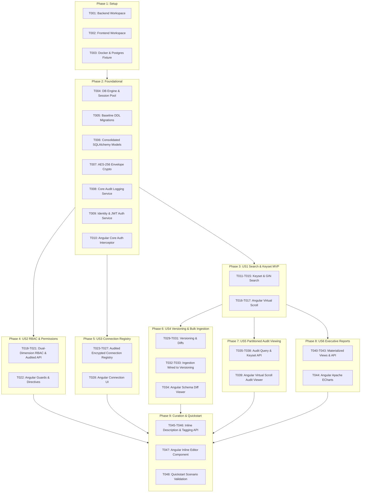

# Tasks: Enterprise Data Catalog (Phase 1 - Core Platform)

**Input**: Design documents from `/specs/001-core-platform/` ([spec.md](spec.md), [plan.md](plan.md), [data-model.md](data-model.md), [research.md](research.md), [contracts/openapi.yaml](contracts/openapi.yaml), [quickstart.md](quickstart.md))  
**Constitution**: Adheres strictly to Enterprise Data Catalog Constitution v1.0.0 (Zero-Laziness, Ambiguity Gate, Strict TDD against real PostgreSQL, Security & Auditing).  
**TDD Mandate**: Every implementation task enforces the **Red-Green-Refactor Protocol**:
- **Step A (Red)**: Write the integration/unit test file (`pytest` with real PostgreSQL container or Angular spec) asserting failure on unbuilt behavior, boundary conditions, or unauthorized access.
- **Step B (Verify Failure)**: Run test execution command confirming failure (Red).
- **Step C (Green)**: Write complete production implementation (Zero TODOs, zero mocks, zero shortcuts).
- **Step D (Verify Pass & Performance)**: Execute test suite verifying pass (Green) and validate query execution plans (`EXPLAIN ANALYZE`) where applicable.

---

## Task Format & Legend

- **Checkbox**: `- [ ]` (Unchecked, reviewer-tracked)
- **Task ID**: `T001` through `T048` sequential execution order
- **[P]**: Parallelizable task (independent files, no incomplete dependencies)
- **[Story]**: `[US1]` through `[US6]` mapping to User Stories from [spec.md](spec.md)

---

## Phase 1: Setup (Shared Infrastructure)

**Purpose**: Initialize backend and frontend workspace layouts, project manifests, Docker/Testcontainers pre-flight verification, and PostgreSQL 16 test fixtures.

- [x] T001 Database Schema & Alembic Migration for Users and RBAC in `backend/alembic/versions/001_users_and_rbac.py`
  - Step A (Red): Create integration test `backend/tests/integration/test_users_and_rbac_schema.py` asserting tables, composite indexes (`idx_perm_rules_eval`, `idx_cat_assign_lookup`), CRUD, and unique constraint enforcement against PostgreSQL.
  - Step B (Verify Failure): Run `pytest backend/tests/integration/test_users_and_rbac_schema.py` and confirm failure (Red).
  - Step C (Green): Implement baseline Alembic migration `001_users_and_rbac.py`, SQLAlchemy models in `backend/src/models/identity.py` and `rbac.py`, and database session factory in `backend/src/core/database.py`.
  - Step D (Verify Pass): Run `pytest backend/tests -v` and confirm 100% PASS (Green) across all 5 integration and environment tests.

- [x] T002 [P] Initialize Angular 18 standalone enterprise frontend workspace in `frontend/package.json`
  - Step A (Red): Create frontend smoke test in `frontend/src/app/app.component.spec.ts` asserting component bootstrap with Angular Signals and Angular CDK.
  - Step B (Verify Failure): Run `npm --prefix frontend test -- --watch=false` and confirm build failure.
  - Step C (Green): Configure `frontend/package.json`, `frontend/tsconfig.json`, `frontend/angular.json`, installing `@angular/core` 18+, `@angular/cdk` 18+, `ngx-echarts` 18+, and `echarts` 5.5+.
  - Step D (Verify Pass): Run `npm --prefix frontend test -- --watch=false` and confirm green pass.

- [x] T003 [P] Configure Docker pre-flight check and real PostgreSQL 16 containerized test fixture in `backend/tests/conftest.py`
  - Step A (Red): Write `backend/tests/unit/test_db_fixture.py` asserting Docker daemon availability via `docker info`, verifying `postgres:16` image presence, and asserting an active async SQLAlchemy connection against a containerized PostgreSQL 16 engine with `uuid-ossp`, `pg_trgm`, and `btree_gist` extensions.
  - Step B (Verify Failure): Run `poetry run pytest backend/tests/unit/test_db_fixture.py` and verify connection/pre-flight failure.
  - Step C (Green): Implement pre-flight Docker validation and `testcontainers-postgres` async fixture in `backend/tests/conftest.py` providing isolated per-test rollback transactions and extension pre-loading.
  - Step D (Verify Pass): Run `poetry run pytest backend/tests/unit/test_db_fixture.py` and confirm Docker readiness and green database ping.

---

## Phase 2: Foundational (Blocking Prerequisites)

**Purpose**: Core database engine configuration, baseline PostgreSQL 16 migration, consolidated SQLAlchemy 2.0 models, envelope encryption, and transactional audit logging infrastructure.

- [x] T004 Implement Database Engine and Session Factory in `backend/src/core/database.py`
  - Step A (Red): Write `backend/tests/integration/test_database_session.py` asserting async session pooling, commit/rollback behavior, and connection recycling.
  - Step B (Verify Failure): Run `poetry run pytest backend/tests/integration/test_database_session.py` and confirm failure.
  - Step C (Green): Implement `create_async_engine`, `async_sessionmaker`, and `get_db_session` dependency in `backend/src/core/database.py` and settings in `backend/src/core/config.py`.
  - Step D (Verify Pass): Run `poetry run pytest backend/tests/integration/test_database_session.py` and confirm pass.

- [x] T005 [P] Setup Alembic migrations and baseline PostgreSQL 16 DDL in `backend/alembic/versions/002_baseline_schema.py`
  - Step A (Red): Write `backend/tests/integration/test_migrations.py` asserting all PostgreSQL 16 enum types, tables, generated columns (`effective_description`, `search_vector`), rules on `audit_logs`, and monthly partitions exist after upgrade.
  - Step B (Verify Failure): Run `poetry run pytest backend/tests/integration/test_migrations.py` and confirm table missing failure.
  - Step C (Green): Implement raw SQL DDL in `backend/alembic/versions/001_baseline_schema.py` applying complete DDL from [data-model.md](data-model.md) including `audit_logs_no_update` and `audit_logs_no_delete` rules.
  - Step D (Verify Pass): Run `poetry run alembic upgrade head` followed by `poetry run pytest backend/tests/integration/test_migrations.py`.

- [ ] T006 [P] Implement Consolidated Core SQLAlchemy 2.0 Models in `backend/src/models/`
  - Step A (Red): Write `backend/tests/unit/test_model_metadata.py` asserting all tables and relationships map to `Base.metadata` matching the database schema for `User`, `Role`, `UserRole` (`identity.py`), `PermissionRule`, `Category`, `CategoryAssignment` (`rbac.py`), `DatabaseSchema`, `CatalogTable`, `CatalogColumn`, `Tag`, `TagAssignment` (`catalog.py`), `DatabaseConnection`, `SyncSchedule` (`connections.py`), `TableVersion`, `SchemaChangeLog` (`versioning.py`), and `AuditLog` (`audit.py`).
  - Step B (Verify Failure): Run `poetry run pytest backend/tests/unit/test_model_metadata.py` and confirm `ImportError` / failure.
  - Step C (Green): Implement all declarative models in `backend/src/models/` matching the full schema in [data-model.md](data-model.md).
  - Step D (Verify Pass): Run `poetry run pytest backend/tests/unit/test_model_metadata.py` and verify 100% metadata alignment.

- [ ] T007 [P] Implement AES-256-GCM Envelope Encryption Service in `backend/src/services/crypto/envelope.py`
  - Step A (Red): Write `backend/tests/unit/test_envelope_crypto.py` testing encrypt/decrypt round-trip of JSON credentials, verifying unique 256-bit DEK generation, 96-bit IV randomness, auth tag validation, and tampering rejection.
  - Step B (Verify Failure): Run `poetry run pytest backend/tests/unit/test_envelope_crypto.py` and confirm failure.
  - Step C (Green): Implement `EnvelopeEncryptionService` in `backend/src/services/crypto/envelope.py` using `cryptography.hazmat.primitives.ciphers.aead.AESGCM` wrapping DEKs with Master KEK (`CATALOG_MASTER_KEK`).
  - Step D (Verify Pass & Performance): Run `poetry run pytest backend/tests/unit/test_envelope_crypto.py` and verify encryption/decryption execution takes `< 5ms` per operation.

- [ ] T008 [P] Implement Core Audit Logging Service & Session Hook in `backend/src/services/audit/audit_service.py`
  - Step A (Red): Write `backend/tests/integration/test_audit_service_core.py` asserting that `record_audit_event` persists an `AuditLog` in the current month partition within the active transaction and rolls back cleanly if transaction fails.
  - Step B (Verify Failure): Run `poetry run pytest backend/tests/integration/test_audit_service_core.py` and confirm failure.
  - Step C (Green): Implement `record_audit_event` and `AuditService` in `backend/src/services/audit/audit_service.py` attached to SQLAlchemy `AsyncSession` flushes.
  - Step D (Verify Pass): Run `poetry run pytest backend/tests/integration/test_audit_service_core.py` and verify atomic transaction recording.

- [ ] T009 Implement Core Identity & JWT Authentication Service in `backend/src/services/auth/jwt_service.py`
  - Step A (Red): Write `backend/tests/integration/test_auth_service.py` asserting user authentication, Argon2id password hashing, JWT issue/validation, expiration handling, and invalid signature rejection.
  - Step B (Verify Failure): Run `poetry run pytest backend/tests/integration/test_auth_service.py` and confirm failure.
  - Step C (Green): Implement `JWTAuthService` in `backend/src/services/auth/jwt_service.py` with claims encoding and password verification.
  - Step D (Verify Pass): Run `poetry run pytest backend/tests/integration/test_auth_service.py` and verify 100% pass.

- [ ] T010 [P] Implement Angular Core Authentication & Interceptor in `frontend/src/app/core/auth/auth.service.ts`
  - Step A (Red): Write `frontend/src/app/core/auth/auth.service.spec.ts` asserting token storage, reactive `currentUser` signal, and `authInterceptor` adding `Authorization: Bearer <token>` header.
  - Step B (Verify Failure): Run `npm --prefix frontend test -- --include src/app/core/auth/auth.service.spec.ts` and confirm failure.
  - Step C (Green): Implement `AuthService` using Angular Signals and `authInterceptor` in `frontend/src/app/core/auth/auth.interceptor.ts`.
  - Step D (Verify Pass): Run `npm --prefix frontend test -- --include src/app/core/auth/auth.service.spec.ts` and confirm pass.

---

## Phase 3: User Story 1 - Metadata Discovery & High-Performance Search with RBAC (Priority: P1) 🎯 MVP

**Goal**: Search across 160,000 tables and 5,000,000 columns in `< 100ms`, returning ranked results filtered directly in SQL by user RBAC and tag policies.

**Independent Test**: Seed a PostgreSQL container with sample tables across multiple databases, assign permissions to User A but deny access to User B, and execute `/api/v1/search?q=keyword` to verify that unauthorized rows are completely omitted from SQL results.

### Tests for User Story 1
- [ ] T011 [P] [US1] Write integration test for SQL-level RBAC search filtering in `backend/tests/integration/test_search_rbac.py`
  - Step A (Red): Assert that users without `VIEW_METADATA` on a database or with an explicit table DENY rule receive 0 search matches, while authorized users receive matching hits with latency `< 100ms`.
  - Step B (Verify Failure): Run `poetry run pytest backend/tests/integration/test_search_rbac.py` and confirm failure.
- [ ] T012 [P] [US1] Write contract test for Keyset Cursor Pagination in `backend/tests/contract/test_keyset_search.py`
  - Step A (Red): Assert that `/api/v1/search` returns `items` and `page_info` (`has_next_page`, `next_cursor`), and that passing `next_cursor` returns consecutive pages deterministically.
  - Step B (Verify Failure): Run `poetry run pytest backend/tests/contract/test_keyset_search.py` and confirm HTTP 404 / failure.

### Implementation for User Story 1
- [ ] T013 [US1] Implement SQL-Pushed RBAC Dependency in `backend/src/api/dependencies/rbac.py`
  - Step C (Green): Implement `require_table_rbac` dependency compiling `EXISTS` subqueries checking `permission_rules` (ALLOW/DENY hierarchy) and tag policies directly into SQLAlchemy `Select` statements.
  - Step D (Verify Pass & Performance): Run `poetry run pytest backend/tests/integration/test_search_rbac.py` and inspect `EXPLAIN ANALYZE` confirming subquery execution uses `idx_perm_rules_eval`.

- [ ] T014 [US1] Implement High-Performance Keyset Search Service in `backend/src/services/catalog/search_service.py`
  - Step C (Green): Implement full-text GIN search using `to_tsquery` and trigram similarity fallback with deterministic keyset cursor sorting `(t.name ASC, t.id ASC)`.
  - Step D (Verify Pass & Performance): Verify test query plans use `idx_tables_search_vector_gin` and `idx_tables_name_trgm_gin` returning in `< 100ms`.

- [ ] T015 [US1] Implement Search & Table Listing API Endpoints in `backend/src/api/v1/search.py` and `backend/src/api/v1/tables.py`
  - Step C (Green): Implement `GET /api/v1/search`, `GET /api/v1/schemas/{schema_id}/tables`, and `GET /api/v1/tables/{table_id}` adhering to [contracts/openapi.yaml](contracts/openapi.yaml).
  - Step D (Verify Pass): Run `poetry run pytest backend/tests/contract/test_keyset_search.py` and confirm 100% pass.

- [ ] T016 [P] [US1] Implement Angular Catalog Signal Store in `frontend/src/app/features/catalog/stores/catalog.store.ts`
  - Step A (Red): Write `frontend/src/app/features/catalog/stores/catalog.store.spec.ts` asserting search query dispatch, cursor appending, and `searchHits` signal updates.
  - Step B (Verify Failure): Run `npm --prefix frontend test -- --include src/app/features/catalog/stores/catalog.store.spec.ts` and confirm failure.
  - Step C (Green): Implement `CatalogStore` using Angular Signals (`signal`, `computed`) managing `searchHits`, `isLoading`, and `hasMore`.
  - Step D (Verify Pass): Run `npm --prefix frontend test -- --include src/app/features/catalog/stores/catalog.store.spec.ts` and confirm pass.

- [ ] T017 [US1] Implement CDK Virtual Scroll Table Component in `frontend/src/app/features/catalog/components/table-virtual-scroll/table-virtual-scroll.component.ts`
  - Step A (Red): Write `table-virtual-scroll.component.spec.ts` testing rendering of 1,000 mock items, verifying that DOM contains only visible row elements.
  - Step B (Verify Failure): Run `npm --prefix frontend test -- --include src/app/features/catalog/components/table-virtual-scroll/table-virtual-scroll.component.spec.ts` and confirm failure.
  - Step C (Green): Implement `<cdk-virtual-scroll-viewport itemSize="48">` rendering catalog items with infinite scroll pagination triggers.
  - Step D (Verify Pass): Verify smooth rendering in Angular test runner without memory accumulation.

---

## Phase 4: User Story 2 - Granular Access Control & Hierarchical Permissions (Priority: P1)

**Goal**: Configure and enforce dual-dimension hierarchical permissions (Database-level and Category-tree) with fine-grained actions and explicit DENY precedence, recording all permission mutations to the immutable audit log.

**Independent Test**: Assign `VIEW_METADATA` on a Database to Role A, assign DENY on Table X to Role A, verify Role A sees all tables except Table X. Assign Category permission to Role B and verify access cascades down the entire sub-tree.

### Tests for User Story 2
- [ ] T018 [P] [US2] Write integration test for Hierarchical RBAC & Category Sub-Tree in `backend/tests/integration/test_rbac_hierarchy.py`
  - Step A (Red): Assert permission inheritance from Database -> Schema -> Table, verify DENY precedence overrides ALLOW, and verify category tree sub-query resolution.
  - Step B (Verify Failure): Run `poetry run pytest backend/tests/integration/test_rbac_hierarchy.py` and confirm failure.
- [ ] T019 [P] [US2] Write contract test for Permission Rules API in `backend/tests/contract/test_permissions_api.py`
  - Step A (Red): Assert CRUD on `/api/v1/permissions` with role assignments, validation of valid actions and resource types, and audit record generation.
  - Step B (Verify Failure): Run `poetry run pytest backend/tests/contract/test_permissions_api.py` and confirm failure.

### Implementation for User Story 2
- [ ] T020 [US2] Implement Category Recursive Tree Traversal Service in `backend/src/services/rbac/category_service.py`
  - Step C (Green): Implement recursive CTE query fetching all descendants of a category node and resolving effective permissions for tagged assets.
  - Step D (Verify Pass & Performance): Run `poetry run pytest backend/tests/integration/test_rbac_hierarchy.py` and verify sub-10ms traversal.

- [ ] T021 [US2] Implement Permissions API Endpoints in `backend/src/api/v1/permissions.py`
  - Step C (Green): Implement endpoints to grant, revoke, and inspect permission rules, atomically recording audit records via `record_audit_event`.
  - Step D (Verify Pass): Run `poetry run pytest backend/tests/contract/test_permissions_api.py` and verify pass and audit log entry.

- [ ] T022 [P] [US2] Implement Angular Route & Directive Guards in `frontend/src/app/core/guards/permission.guard.ts` and `frontend/src/app/core/directives/has-permission.directive.ts`
  - Step A (Red): Write unit specs testing route blocking for unauthorized actions and DOM removal via `*hasPermission`.
  - Step B (Verify Failure): Run Angular tests and confirm failure.
  - Step C (Green): Implement `permissionGuard` CanActivateFn and `HasPermissionDirective` using Signals.
  - Step D (Verify Pass): Run Angular tests and confirm 100% green pass.

---

## Phase 5: User Story 3 - Database Connection Registry & Secure Credential Storage (Priority: P1)

**Goal**: Register, configure, and secure database connections for PostgreSQL, MSSQL, Oracle, MySQL, and ClickHouse with 5-part cron schedules, AES-256-GCM envelope encryption, and audit log generation.

**Independent Test**: Register a connection with password and SSL cert, verify ciphertext in PostgreSQL is AES-256-GCM encrypted with zero plaintext, and run live connection ping test.

### Tests for User Story 3
- [ ] T023 [P] [US3] Write integration test for Database Connection Registry in `backend/tests/integration/test_connections.py`
  - Step A (Red): Assert connection creation encrypts credentials with unique DEK, rejects invalid 5-part cron schedules, masks credentials in API responses, and generates audit log entry.
  - Step B (Verify Failure): Run `poetry run pytest backend/tests/integration/test_connections.py` and confirm failure.
- [ ] T024 [P] [US3] Write integration test for Dialect Connection Testing in `backend/tests/integration/test_connection_ping.py`
  - Step A (Red): Assert that `/api/v1/connections/{id}/test` attempts dialect ping with 5s timeout and returns latency and diagnostic error structures.
  - Step B (Verify Failure): Run `poetry run pytest backend/tests/integration/test_connection_ping.py` and confirm failure.

### Implementation for User Story 3
- [ ] T025 [US3] Implement Connection Registry Service in `backend/src/services/connections/connection_service.py`
  - Step C (Green): Implement CRUD with `EnvelopeEncryptionService` and `record_audit_event` integration, ensuring credentials decrypted only in memory during test pings.
  - Step D (Verify Pass): Run `poetry run pytest backend/tests/integration/test_connections.py` and verify zero plaintext in DB.

- [ ] T026 [US3] Implement Async Dialect Ping Service in `backend/src/services/connections/ping_service.py`
  - Step C (Green): Implement lightweight dialect pingers for PostgreSQL (`SELECT 1`), MSSQL, MySQL, Oracle, ClickHouse with `asyncio.wait_for(timeout=5.0)`.
  - Step D (Verify Pass): Run `poetry run pytest backend/tests/integration/test_connection_ping.py` and verify structured failure reports.

- [ ] T027 [US3] Implement Connection Endpoints in `backend/src/api/v1/connections.py`
  - Step C (Green): Implement `POST /api/v1/connections`, `GET /api/v1/connections`, and `POST /api/v1/connections/{id}/test`.
  - Step D (Verify Pass): Run contract test suite verifying redacted credential response and audit record.

- [ ] T028 [P] [US3] Implement Angular Connection Management UI in `frontend/src/app/features/connections/connection-list.component.ts`
  - Step A (Red): Write component spec testing connection list rendering, status badges, and test connection button dispatch.
  - Step B (Verify Failure): Run Angular test runner and confirm failure.
  - Step C (Green): Implement standalone `ConnectionListComponent` and `ConnectionDialogComponent` with cron validation feedback.
  - Step D (Verify Pass): Run Angular test runner and confirm green pass.

---

## Phase 6: User Story 4 - Table History, Schema Versioning & Bulk Ingestion (Priority: P2)

**Goal**: Track table snapshot versions, column-level changes (`COLUMN_ADDED`, `TYPE_CHANGED`, `DESCRIPTION_UPDATED`), provide side-by-side diff comparisons, and automatically trigger versioning and change logs during bulk metadata ingestion.

**Independent Test**: Execute bulk ingestion with modified column types and new columns, verify that `TableVersion` snapshots and `SchemaChangeLog` records are automatically generated while preserving user-curated descriptions, and query `/api/v1/tables/{id}/versions/compare` to verify the delta.

### Tests for User Story 4
- [ ] T029 [P] [US4] Write integration test for Table Versioning & Change Logs in `backend/tests/integration/test_versioning.py`
  - Step A (Red): Assert snapshot creation, version number increment, and column delta calculation between version snapshots.
  - Step B (Verify Failure): Run `poetry run pytest backend/tests/integration/test_versioning.py` and confirm failure.
- [ ] T030 [P] [US4] Write contract test for Schema Version Diff API in `backend/tests/contract/test_version_diff_api.py`
  - Step A (Red): Assert `/api/v1/tables/{table_id}/versions/compare?v1=1&v2=2` returns `added_columns`, `removed_columns`, and `modified_columns`.
  - Step B (Verify Failure): Run `poetry run pytest backend/tests/contract/test_version_diff_api.py` and confirm failure.

### Implementation for User Story 4
- [ ] T031 [US4] Implement Version Snapshot & Diff Calculation Engine in `backend/src/services/catalog/version_service.py`
  - Step C (Green): Implement JSONB snapshot generation and side-by-side structural comparison logic detecting added, removed, and type-modified columns.
  - Step D (Verify Pass): Run `poetry run pytest backend/tests/integration/test_versioning.py` and verify exact delta detection.

- [ ] T032 [US4] Implement Bulk Ingestion Service Wired to Version Snapshots in `backend/src/services/ingestion/bulk_ingestion_service.py`
  - Step A (Red): Write `backend/tests/integration/test_bulk_ingestion.py` asserting batch upsert (`INSERT ... ON CONFLICT DO UPDATE`) updates `source_description` and attributes without clearing `approved_description`, soft-deletes missing tables/columns as `DELETED`, and triggers `version_service` to generate new `TableVersion` and `SchemaChangeLog` rows on structural mutations.
  - Step B (Verify Failure): Run `poetry run pytest backend/tests/integration/test_bulk_ingestion.py` and confirm failure.
  - Step C (Green): Implement `BulkIngestionService` executing batch upserts in transactions and calling `version_service.capture_version_if_changed` and `record_audit_event`.
  - Step D (Verify Pass): Run `poetry run pytest backend/tests/integration/test_bulk_ingestion.py` and confirm description preservation and version snapshot creation.

- [ ] T033 [US4] Implement Version History & Bulk Ingestion Endpoints in `backend/src/api/v1/versions.py` and `backend/src/api/v1/ingestion.py`
  - Step C (Green): Implement `GET /api/v1/tables/{table_id}/versions`, `GET /api/v1/tables/{table_id}/versions/compare`, and `POST /api/v1/ingestion/bulk`.
  - Step D (Verify Pass): Run `poetry run pytest backend/tests/contract/test_version_diff_api.py` and confirm pass.

- [ ] T034 [P] [US4] Implement Angular Schema Diff Viewer Component in `frontend/src/app/features/versioning/version-diff.component.ts`
  - Step A (Red): Write component spec testing side-by-side display of added columns (green), removed (red), and changed types (amber).
  - Step B (Verify Failure): Run Angular tests and confirm failure.
  - Step C (Green): Implement standalone `VersionDiffComponent` with visual color-coded badges.
  - Step D (Verify Pass): Run Angular tests and confirm pass.

---

## Phase 7: User Story 5 - Immutable Audit Logging & Security Auditing (Priority: P2)

**Goal**: Provide month-partitioned, immutable audit log querying, filtering, and virtual-scroll inspection for compliance auditors.

**Independent Test**: Query `/api/v1/audit-logs` with entity and date filters, verify partition pruning in PostgreSQL, and execute a direct SQL `DELETE` to verify that PostgreSQL blocks the deletion.

### Tests for User Story 5
- [ ] T035 [P] [US5] Write integration test for Partitioned Audit Log Immutability & Pruning in `backend/tests/integration/test_audit_logging.py`
  - Step A (Red): Assert that direct SQL `UPDATE` or `DELETE` on `audit_logs` raises an exception or does nothing, and verify query execution plans prune non-matching month partitions.
  - Step B (Verify Failure): Run `poetry run pytest backend/tests/integration/test_audit_logging.py` and confirm failure.
- [ ] T036 [P] [US5] Write contract test for Audit Log Filtering API in `backend/tests/contract/test_audit_api.py`
  - Step A (Red): Assert `/api/v1/audit-logs` supports filtering by `entity_type`, `entity_id`, `actor_id`, and keyset pagination.
  - Step B (Verify Failure): Run `poetry run pytest backend/tests/contract/test_audit_api.py` and confirm failure.

### Implementation for User Story 5
- [ ] T037 [US5] Implement Keyset-Paginated Audit Query Service in `backend/src/services/audit/audit_query_service.py`
  - Step C (Green): Implement partition-pruned keyset query service filtering by actor, entity type, entity ID, and timestamp range.
  - Step D (Verify Pass & Performance): Verify query plan uses `idx_audit_logs_entity_created` and `idx_audit_logs_actor_created`.

- [ ] T038 [US5] Implement Keyset-Paginated Audit Log Endpoints in `backend/src/api/v1/audit_logs.py`
  - Step C (Green): Implement `GET /api/v1/audit-logs` conforming to [contracts/openapi.yaml](contracts/openapi.yaml).
  - Step D (Verify Pass): Run `poetry run pytest backend/tests/contract/test_audit_api.py` and confirm pass.

- [ ] T039 [P] [US5] Implement Angular Virtual Scroll Audit Viewer in `frontend/src/app/features/audit/audit-log-viewer.component.ts`
  - Step A (Red): Write component spec testing virtual scrolling through audit log records and JSON diff modal display.
  - Step B (Verify Failure): Run Angular tests and confirm failure.
  - Step C (Green): Implement standalone `AuditLogViewerComponent` using Angular CDK Virtual Scroll.
  - Step D (Verify Pass): Run Angular tests and confirm pass.

---

## Phase 8: User Story 6 - Executive & Governance Reporting Dashboard (Priority: P2)

**Goal**: Deliver sub-200ms executive management reports across all 800 databases using concurrently refreshed PostgreSQL Materialized Views and Angular Apache ECharts.

**Independent Test**: Populate test database, run materialized view concurrent refresh, and verify `/api/v1/reports/completeness` responds in `< 100ms` with accurate completeness percentages.

### Tests for User Story 6
- [ ] T040 [P] [US6] Write integration test for Materialized View Refresh & Reporting in `backend/tests/integration/test_reports.py`
  - Step A (Red): Assert `mv_metadata_completeness` and `mv_classification_distribution` compute correct counts and refresh concurrently without blocking reads.
  - Step B (Verify Failure): Run `poetry run pytest backend/tests/integration/test_reports.py` and confirm failure.
- [ ] T041 [P] [US6] Write contract test for Reporting APIs in `backend/tests/contract/test_reports_api.py`
  - Step A (Red): Assert `/api/v1/reports/completeness` and `/api/v1/reports/classification-distribution` return expected aggregated JSON payloads in `< 200ms`.
  - Step B (Verify Failure): Run `poetry run pytest backend/tests/contract/test_reports_api.py` and confirm failure.

### Implementation for User Story 6
- [ ] T042 [P] [US6] Implement Materialized Views & Concurrent Refresh Service in `backend/src/services/reporting/report_service.py`
  - Step C (Green): Implement DDL/ORM query for materialized views and `refresh_all_materialized_views_concurrently` method.
  - Step D (Verify Pass & Performance): Run `poetry run pytest backend/tests/integration/test_reports.py` and confirm query latency `< 50ms`.

- [ ] T043 [US6] Implement Executive Reporting API Endpoints in `backend/src/api/v1/reports.py`
  - Step C (Green): Implement `GET /api/v1/reports/completeness` and `GET /api/v1/reports/classification-distribution`.
  - Step D (Verify Pass): Run `poetry run pytest backend/tests/contract/test_reports_api.py` and verify sub-200ms latency.

- [ ] T044 [P] [US6] Implement Angular Apache ECharts Executive Widgets in `frontend/src/app/features/reports/executive-dashboard.component.ts`
  - Step A (Red): Write component specs testing completeness gauge and classification distribution charts rendering without errors.
  - Step B (Verify Failure): Run Angular tests and confirm failure.
  - Step C (Green): Implement `ExecutiveDashboardComponent`, `CompletenessGaugeComponent`, and `ClassificationSunburstComponent` with `ngx-echarts` Canvas rendering.
  - Step D (Verify Pass): Run Angular tests and verify 60 FPS animation without DOM lag.

---

## Phase 9: Curation, Tagging & End-to-End Validation

**Purpose**: Deliver inline description curation and bulk tagging operations with schema change logging and audit tracking, followed by full quickstart verification.

- [ ] T045 [P] Write integration test for Inline Description Editing & Bulk Tagging in `backend/tests/integration/test_curation_tagging.py`
  - Step A (Red): Assert that updating table/column approved description records `DESCRIPTION_UPDATED` in `schema_change_logs` and an `AuditLog` entry, and verify bulk tag assignment updates `tag_assignments` atomically.
  - Step B (Verify Failure): Run `poetry run pytest backend/tests/integration/test_curation_tagging.py` and confirm failure.
- [ ] T046 Implement Inline Description Editing & Bulk Tagging Endpoints in `backend/src/api/v1/tables.py` and `backend/src/api/v1/tags.py`
  - Step C (Green): Implement `PATCH /api/v1/tables/{table_id}/description`, `PATCH /api/v1/columns/{column_id}/description`, and `POST /api/v1/tags/bulk-assign` with audit logging and change log records.
  - Step D (Verify Pass): Run `poetry run pytest backend/tests/integration/test_curation_tagging.py` and confirm pass.

- [ ] T047 [P] Implement Angular Inline Description Editor & Tag Chip Component in `frontend/src/app/features/catalog/components/inline-desc-editor/inline-desc-editor.component.ts`
  - Step A (Red): Write component spec testing inline click-to-edit, save dispatch, cancel rollback, and tag chip display.
  - Step B (Verify Failure): Run Angular tests and confirm failure.
  - Step C (Green): Implement standalone `InlineDescEditorComponent` and `TagChipComponent`.
  - Step D (Verify Pass): Run Angular tests and confirm pass.

- [ ] T048 Execute Full Quickstart Validation Scenarios in `specs/001-core-platform/quickstart.md`
  - Step A (Red): Run validation test harness asserting all 5 scenarios from `quickstart.md` pass against running services.
  - Step B (Verify Failure): Identify any failing integration or boundary condition.
  - Step C (Green): Resolve any integration gaps and verify complete end-to-end flow.
  - Step D (Verify Pass): Verify search < 100ms, CDK virtual scroll 60 FPS, and zero plaintext credentials.

---

## Dependencies & Execution Order

---

## Parallel Execution Opportunities

- **Phase 1 Setup**: `T002` (Frontend) and `T003` (Docker & Postgres Container) can run in parallel once `T001` initializes.
- **Phase 2 Foundational**:
  - `T005` (Alembic Baseline DDL) and `T006` (Consolidated SQLAlchemy Models) run together after `T004`.
  - `T007` (AES-256 Crypto), `T008` (Audit Service), and `T010` (Angular Auth) can run in parallel with `T009`.
- **User Stories (Phases 3–8)**:
  - Once Phase 2 completes, `US1` (Search MVP), `US2` (Hierarchical RBAC), and `US3` (Connection Registry) can proceed in parallel.
  - In every user story, test writing (`Step A`) and Angular UI components (`Step C`) can be developed concurrently with backend services.

---

## Implementation Strategy & MVP Scope

1. **Target MVP (Phase 1 + Phase 2 + Phase 3: User Story 1)**:
   - Delivers functional catalog search across 160k tables, GIN index acceleration, deterministic keyset cursor pagination, and Angular 18 CDK Virtual Scroll rendering at 60 FPS.
2. **Incremental Delivery (Phases 4–8)**:
   - Increment 1: User Story 2 (RBAC & Category Hierarchy with atomic audit logging).
   - Increment 2: User Story 3 (Secure Database Connection Registry & Dialect Pings).
   - Increment 3: User Story 4 (Table Version Diffs and Bulk Ingestion automatically triggering snapshots).
   - Increment 4: User Story 5 & 6 (Partitioned Audit Log Viewer and Concurrently Refreshed Materialized Views with Executive ECharts).
3. **Enterprise Compliance**:
   - Zero mocked ORM sessions; all integration tests execute against real PostgreSQL instances via `testcontainers-postgres`.
