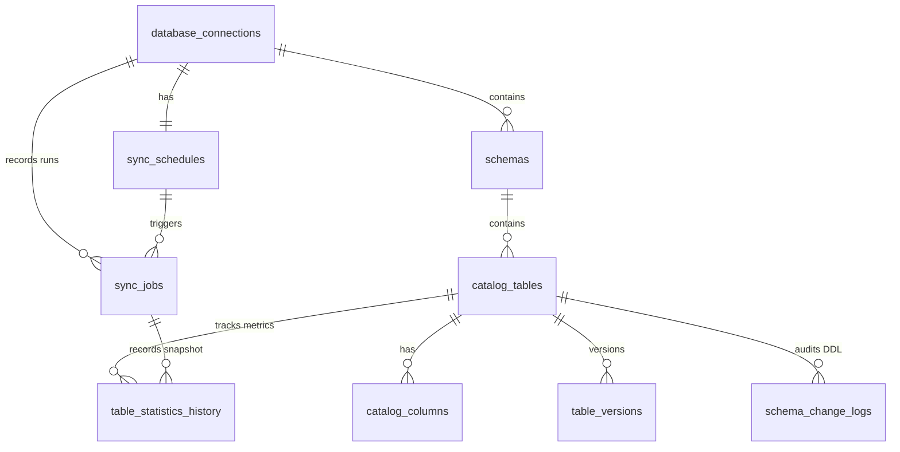
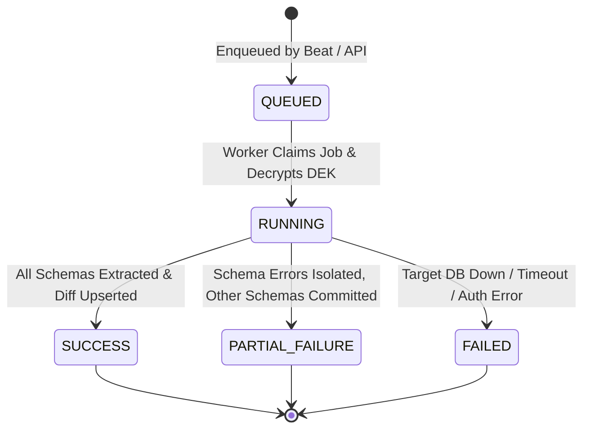
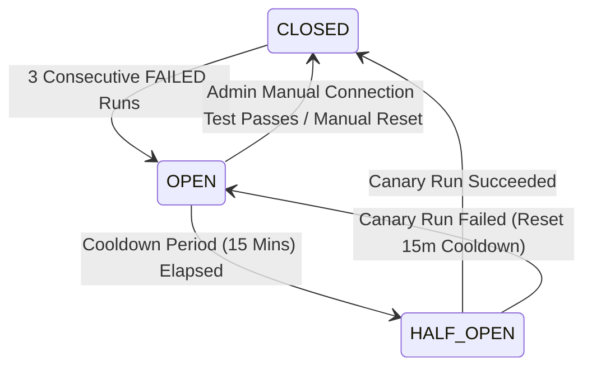
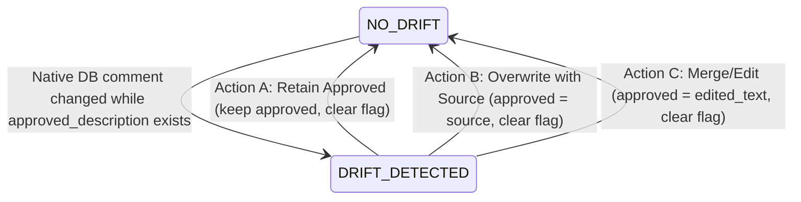

# Phase 2 Data Model & Entity Specifications

**Feature**: Phase 2 Database Connectors, Distributed Workers, and Dynamic Scheduler  
**Branch**: `002-connectors-workers-scheduler`  
**Date**: 2026-11-16  

---

## 1. Architectural Principles & Schema Alignment

Phase 2 builds directly upon the existing `001-core-platform` schema. In accordance with project governance, **no duplicate or parallel tables are created**. Existing core models (`DatabaseConnection`, `SyncSchedule`, `DatabaseSchema`, `CatalogTable`, `CatalogColumn`, `TableVersion`, `SchemaChangeLog`, `AuditLog`) are extended, and two new specialized tables (`sync_jobs` and `table_statistics_history`) are introduced.



---

## 2. New Database Entities

### 2.1 `SyncJob` (`sync_jobs`)
Represents an individual execution of a metadata extraction, introspection, diff, and ingestion job.

| Column | Type | Constraints | Description |
|---|---|---|---|
| `id` | `UUID` | `PRIMARY KEY`, Default: `gen_random_uuid()` | Unique execution job identifier |
| `connection_id` | `UUID` | `NOT NULL`, `FK -> database_connections.id ON DELETE CASCADE` | Associated database connection profile |
| `schedule_id` | `UUID` | `NULLABLE`, `FK -> sync_schedules.id ON DELETE SET NULL` | Originating schedule if triggered by scheduler |
| `status` | `VARCHAR(50)` | `NOT NULL`, Default: `'QUEUED'` | Execution state: `QUEUED`, `RUNNING`, `SUCCESS`, `PARTIAL_FAILURE`, `FAILED` |
| `triggered_by` | `VARCHAR(50)` | `NOT NULL`, Default: `'SCHEDULE'` | Trigger mode: `SCHEDULE`, `MANUAL`, `RETRY` |
| `started_at` | `TIMESTAMPTZ` | `NULLABLE` | Timestamp when worker claimed and started execution |
| `completed_at` | `TIMESTAMPTZ` | `NULLABLE` | Timestamp when worker completed or terminated |
| `duration_ms` | `INTEGER` | `NULLABLE` | Total execution elapsed time in milliseconds |
| `tables_scanned` | `INTEGER` | `NOT NULL`, Default: `0` | Number of tables extracted from target database |
| `tables_created` | `INTEGER` | `NOT NULL`, Default: `0` | Number of new tables inserted into catalog |
| `tables_updated` | `INTEGER` | `NOT NULL`, Default: `0` | Number of existing tables updated in catalog |
| `tables_deleted` | `INTEGER` | `NOT NULL`, Default: `0` | Number of dropped tables soft-deleted (`DELETED`) |
| `columns_scanned` | `INTEGER` | `NOT NULL`, Default: `0` | Total columns extracted across all tables |
| `changes_detected` | `INTEGER` | `NOT NULL`, Default: `0` | Total structural DDL deltas detected |
| `error_message` | `TEXT` | `NULLABLE` | Primary human-readable failure summary |
| `error_trace_jsonb` | `JSONB` | `NOT NULL`, Default: `'{}'::jsonb` | Structured per-schema diagnostics and stack traces |
| `created_at` | `TIMESTAMPTZ` | `NOT NULL`, Default: `clock_timestamp()` | Job registration timestamp |

#### Indexes:
- `idx_sync_jobs_connection_started`: `(connection_id, started_at DESC)` for fast connection history views.
- `idx_sync_jobs_status`: `(status)` for live monitoring of active/queued tasks.
- `idx_sync_jobs_created_at`: `(created_at DESC)` for cursor pagination on the execution monitor.

---

### 2.2 `TableStatisticsHistory` (`table_statistics_history`)
Lightweight, append-only time-series table tracking routine metric updates (row counts, size estimates) over time without triggering structural `TableVersion` snapshots or `SchemaChangeLog` entries.

| Column | Type | Constraints | Description |
|---|---|---|---|
| `id` | `UUID` | `PRIMARY KEY`, Default: `gen_random_uuid()` | Unique observation identifier |
| `table_id` | `UUID` | `NOT NULL`, `FK -> catalog_tables.id ON DELETE CASCADE` | Associated catalog table |
| `recorded_at` | `TIMESTAMPTZ` | `NOT NULL`, Default: `clock_timestamp()` | Observation timestamp |
| `row_count_estimate` | `BIGINT` | `NOT NULL`, Default: `0` | Extracted live row count estimate |
| `size_bytes` | `BIGINT` | `NOT NULL`, Default: `0` | Extracted total relation size in bytes |
| `sync_job_id` | `UUID` | `NULLABLE`, `FK -> sync_jobs.id ON DELETE SET NULL` | Reference to the sync job that observed the metrics |

#### Indexes:
- `idx_table_stats_table_time`: `(table_id, recorded_at DESC)` for high-speed time-series analytics and sparklines.
- `idx_table_stats_sync_job`: `(sync_job_id)` for tracing metrics back to specific ingestion runs.

---

## 3. Schema Extensions to Existing Entities

### 3.1 `sync_schedules` Extensions (Circuit Breaker)
To support autonomous worker resilience and circuit breaking without separate tables:

```sql
ALTER TABLE sync_schedules
    ADD COLUMN IF NOT EXISTS consecutive_failures INTEGER NOT NULL DEFAULT 0,
    ADD COLUMN IF NOT EXISTS circuit_state VARCHAR(20) NOT NULL DEFAULT 'CLOSED',
    ADD COLUMN IF NOT EXISTS cooldown_until TIMESTAMPTZ;
```

- `consecutive_failures`: Incremented on `FAILED` runs; reset to `0` on `SUCCESS` or `PARTIAL_FAILURE`.
- `circuit_state`: Enum string (`'CLOSED'`, `'OPEN'`, `'HALF_OPEN'`).
- `cooldown_until`: Timestamp when an `OPEN` circuit transitions to `HALF_OPEN`.

---

### 3.2 `catalog_tables` & `catalog_columns` Extensions (Description Drift)
To track and resolve divergence between source database comments and human curation:

```sql
ALTER TABLE catalog_tables
    ADD COLUMN IF NOT EXISTS description_drift_detected BOOLEAN NOT NULL DEFAULT FALSE;

ALTER TABLE catalog_columns
    ADD COLUMN IF NOT EXISTS description_drift_detected BOOLEAN NOT NULL DEFAULT FALSE;
```

- When native DB comments change and an `approved_description` exists with different content, `description_drift_detected` is set to `TRUE`.
- Resolving the drift through the UI resets `description_drift_detected` to `FALSE`.

---

### 3.3 `schema_change_type_enum` Extension
```sql
ALTER TYPE schema_change_type_enum ADD VALUE IF NOT EXISTS 'DESCRIPTION_DRIFT';
```
Allows logging description drift occurrences into `schema_change_logs` without incrementing structural `TableVersion`.

---

## 4. State Machines & Lifecycles

### 4.1 Sync Job Execution State Machine



#### Rules:
1. `QUEUED` $\rightarrow$ `RUNNING`: Worker acquires task, registers start time, logs worker host in context.
2. `PARTIAL_FAILURE`: At least one schema succeeded and was committed; failed schemas are recorded in `error_trace_jsonb` and **never** soft-deleted.
3. `FAILED`: Catastrophic connectivity failure, credential authentication failure, or worker crash before any schema could be ingested.

---

### 4.2 Circuit Breaker State Machine



- In `CLOSED`, the scheduler triggers jobs normally based on cron expressions.
- In `OPEN`, the scheduler skips automatic task dispatching, logging a skipped event.
- In `HALF_OPEN`, exactly one worker task is enqueued to probe target health.
- Admin manual test connection (`POST /api/v1/connections/{id}/test`) verifies credentials and reset `consecutive_failures = 0`, `circuit_state = 'CLOSED'`.

---

### 4.3 Description Drift Resolution Workflow



---

## 5. Metadata Connector Domain Models (Pydantic / Dataclasses)

These domain models define the standardized data contracts returned by `BaseMetadataConnector`:

```python
from dataclasses import dataclass, field
from datetime import datetime
from typing import Any, Dict, List, Optional
from enum import Enum

class ConnectorEngine(str, Enum):
    POSTGRESQL = "POSTGRESQL"
    MSSQL = "MSSQL"
    ORACLE = "ORACLE"

@dataclass(frozen=True)
class ConnectionTestResult:
    success: bool
    latency_ms: float
    dialect: str
    server_version: Optional[str]
    message: str
    diagnostic_details: Dict[str, Any] = field(default_factory=dict)
    tested_at: datetime = field(default_factory=lambda: datetime.now(timezone.utc))

@dataclass
class SchemaMetadata:
    name: str
    description: Optional[str] = None
    owner: Optional[str] = None

@dataclass
class TableMetadata:
    schema_name: str
    name: str
    table_type: str  # "TABLE", "VIEW", "MATERIALIZED_VIEW", "PARTITIONED_TABLE"
    row_count_estimate: int = 0
    size_bytes: int = 0
    source_description: Optional[str] = None
    owner: Optional[str] = None
    custom_properties: Dict[str, Any] = field(default_factory=dict)

@dataclass
class ColumnMetadata:
    schema_name: str
    table_name: str
    name: str
    ordinal_position: int
    data_type: str
    raw_data_type: str
    is_nullable: bool = True
    is_primary_key: bool = False
    is_foreign_key: bool = False
    default_value: Optional[str] = None
    source_description: Optional[str] = None

@dataclass
class ForeignKeyMetadata:
    schema_name: str
    table_name: str
    column_name: str
    foreign_schema_name: str
    foreign_table_name: str
    foreign_column_name: str
    constraint_name: str

@dataclass
class TableStatisticsMetadata:
    schema_name: str
    table_name: str
    row_count_estimate: int
    size_bytes: int

@dataclass
class SchemaExtractionResult:
    schema: SchemaMetadata
    tables: List[TableMetadata] = field(default_factory=list)
    columns: List[ColumnMetadata] = field(default_factory=list)
    foreign_keys: List[ForeignKeyMetadata] = field(default_factory=list)
    statistics: List[TableStatisticsMetadata] = field(default_factory=list)
    success: bool = True
    error_message: Optional[str] = None
    error_code: Optional[str] = None
```

---

## 6. PostgreSQL Ingestion Vector Parameters (`UNNEST`)

For maximum performance, `BulkIngestionService` binds flat arrays into PostgreSQL `UNNEST` calls:

### Table Batch Vectors:
- `ids: UUID[]`
- `schema_ids: UUID[]`
- `names: VARCHAR[]`
- `table_types: table_type_enum[]`
- `row_counts: BIGINT[]`
- `sizes: BIGINT[]`
- `source_descriptions: TEXT[]`
- `owners: VARCHAR[]`
- `custom_props: JSONB[]`

### Column Batch Vectors:
- `ids: UUID[]`
- `table_ids: UUID[]`
- `names: VARCHAR[]`
- `ordinal_positions: INT[]`
- `data_types: VARCHAR[]`
- `raw_data_types: VARCHAR[]`
- `is_nullables: BOOLEAN[]`
- `is_pks: BOOLEAN[]`
- `is_fks: BOOLEAN[]`
- `default_values: TEXT[]`
- `source_descriptions: TEXT[]`
- `classification_levels: classification_level_enum[]`
