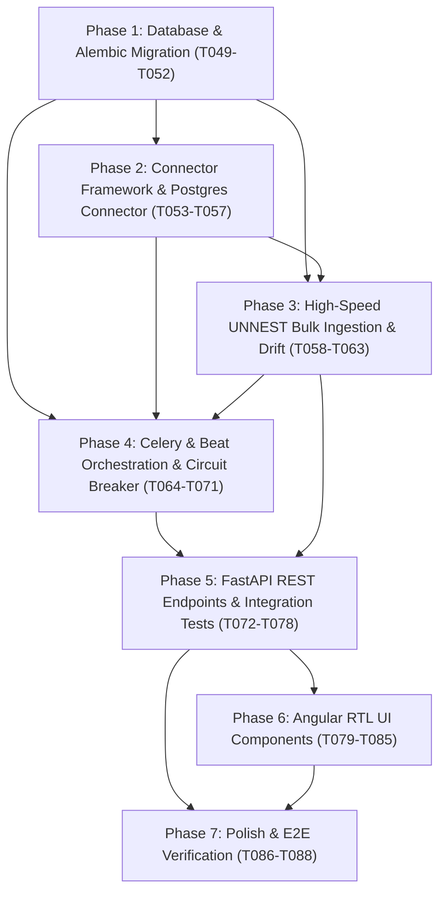

# Tasks: Phase 2 Database Connectors, Distributed Workers, and Dynamic Scheduler

**Input**: Design documents from `/specs/002-connectors-workers-scheduler/` ([spec.md](spec.md), [plan.md](plan.md), [data-model.md](data-model.md), [research.md](research.md), [contracts/openapi.yaml](contracts/openapi.yaml), [quickstart.md](quickstart.md))  
**Constitution**: Adheres strictly to Enterprise Data Catalog Constitution v1.0.0 (Zero-Laziness, Ambiguity Gate, Strict TDD against real PostgreSQL, Security & Auditing).  
**TDD Mandate**: Every implementation task enforces the **Red-Green-Refactor Protocol**:
- **Step A (Red)**: Write the integration/unit test file (`pytest` with real PostgreSQL container or Angular spec) asserting failure on unbuilt behavior, boundary conditions, or unauthorized access.
- **Step B (Verify Failure)**: Run test execution command confirming failure (Red).
- **Step C (Green)**: Write complete production implementation (Zero TODOs, zero mocks, zero shortcuts).
- **Step D (Verify Pass & Performance)**: Execute test suite verifying pass (Green) and validate query execution plans (`EXPLAIN ANALYZE`) where applicable.

---

## Task Format & Legend

- **Checkbox**: `- [ ]` (Unchecked, reviewer-tracked)
- **Task ID**: `T049` through `T094` sequential execution order (strictly continuing from Phase 1's `T001`–`T048`)
- **[P]**: Parallelizable task (independent files, no incomplete dependencies)
- **[Story]**: `[US1]` through `[US4]` mapping to User Stories from [spec.md](spec.md):
  - `[US1]`: User Story 1 (Priority P1) - Automated Scheduled Metadata Extraction via Distributed Workers
  - `[US2]`: User Story 2 (Priority P1) - Pluggable System-Catalog Connector Extraction
  - `[US3]`: User Story 3 (Priority P2) - High-Speed Diffing, Human-Curation Preservation, and Schema Versioning
  - `[US4]`: User Story 4 (Priority P3) - Resilient Execution, Concurrency Pools, and Circuit Breaking

---

## Phase 1: Database & Alembic Migration (`004_phase2_sync_and_stats.py`)

**Purpose**: Database schema expansion for sync execution tracking, lightweight time-series table metrics, circuit breaker state, description drift indicators, and drift audit logging.

- [X] T049 Alembic migration for Phase 2 entities and schema extensions in `backend/alembic/versions/004_phase2_sync_and_stats.py`
  - Step A (Red): Create integration test `backend/tests/integration/test_phase2_migrations.py` asserting schema upgrade and downgrade, verifying presence of tables `sync_jobs` and `table_statistics_history`, checking new columns on `sync_schedules`, `catalog_tables`, and `catalog_columns`, and confirming `DESCRIPTION_DRIFT` value exists in `schema_change_type_enum`.
  - Step B (Verify Failure): Run `poetry run pytest backend/tests/integration/test_phase2_migrations.py` and confirm failure (Red).
  - Step C (Green): Implement Alembic migration `backend/alembic/versions/004_phase2_sync_and_stats.py` (down_revision `006_perm_integrity_partitions`) defining:
    - Table `sync_jobs`: `id UUID PRIMARY KEY DEFAULT gen_random_uuid()`, `connection_id UUID NOT NULL REFERENCES database_connections(id) ON DELETE CASCADE`, `schedule_id UUID NULL REFERENCES sync_schedules(id) ON DELETE SET NULL`, `status VARCHAR(50) NOT NULL DEFAULT 'QUEUED'`, `triggered_by VARCHAR(50) NOT NULL DEFAULT 'SCHEDULE'`, `started_at TIMESTAMPTZ NULL`, `completed_at TIMESTAMPTZ NULL`, `duration_ms INTEGER NULL`, `tables_scanned INTEGER NOT NULL DEFAULT 0`, `tables_created INTEGER NOT NULL DEFAULT 0`, `tables_updated INTEGER NOT NULL DEFAULT 0`, `tables_deleted INTEGER NOT NULL DEFAULT 0`, `columns_scanned INTEGER NOT NULL DEFAULT 0`, `changes_detected INTEGER NOT NULL DEFAULT 0`, `error_message TEXT NULL`, `error_trace_jsonb JSONB NOT NULL DEFAULT '{}'::jsonb`, `created_at TIMESTAMPTZ NOT NULL DEFAULT clock_timestamp()`.
    - Indexes: `idx_sync_jobs_connection_started` on `(connection_id, started_at DESC)`, `idx_sync_jobs_status` on `(status)`, and `idx_sync_jobs_created_at` on `(created_at DESC)`.
    - Table `table_statistics_history`: `id UUID PRIMARY KEY DEFAULT gen_random_uuid()`, `table_id UUID NOT NULL REFERENCES catalog_tables(id) ON DELETE CASCADE`, `recorded_at TIMESTAMPTZ NOT NULL DEFAULT clock_timestamp()`, `row_count_estimate BIGINT NOT NULL DEFAULT 0`, `size_bytes BIGINT NOT NULL DEFAULT 0`, `sync_job_id UUID NULL REFERENCES sync_jobs(id) ON DELETE SET NULL`.
    - Indexes: `idx_table_stats_table_time` on `(table_id, recorded_at DESC)` and `idx_table_stats_sync_job` on `(sync_job_id)`.
    - Column additions: `sync_schedules.consecutive_failures INTEGER NOT NULL DEFAULT 0`, `sync_schedules.circuit_state VARCHAR(20) NOT NULL DEFAULT 'CLOSED'`, `sync_schedules.cooldown_until TIMESTAMPTZ NULL`.
    - Column additions: `catalog_tables.description_drift_detected BOOLEAN NOT NULL DEFAULT FALSE`, `catalog_columns.description_drift_detected BOOLEAN NOT NULL DEFAULT FALSE`.
    - Enum extension: `ALTER TYPE schema_change_type_enum ADD VALUE IF NOT EXISTS 'DESCRIPTION_DRIFT'`.
  - Step D (Verify Pass): Run `poetry run pytest backend/tests/integration/test_phase2_migrations.py` and confirm 100% green pass.

- [X] T050 [P] SQLAlchemy 2.0 ORM models for `SyncJob` and `TableStatisticsHistory` in `backend/src/models/sync_jobs.py` and `backend/src/models/statistics.py`
  - Step A (Red): Create unit test in `backend/tests/unit/test_phase2_models.py` asserting model attribute definitions, table names, foreign keys, cascade configurations, and default values.
  - Step B (Verify Failure): Run `poetry run pytest backend/tests/unit/test_phase2_models.py` and verify import and class definition errors.
  - Step C (Green): Implement `SyncJob` in `backend/src/models/sync_jobs.py` and `TableStatisticsHistory` in `backend/src/models/statistics.py` using SQLAlchemy 2.0 `Mapped` and `mapped_column`, exporting them in `backend/src/models/__init__.py`.
  - Step D (Verify Pass): Run `poetry run pytest backend/tests/unit/test_phase2_models.py` and confirm all model assertions pass.

- [X] T051 [P] SQLAlchemy 2.0 ORM model extensions for `SyncSchedule`, `CatalogTable`, and `CatalogColumn` in `backend/src/models/connections.py` and `backend/src/models/catalog.py`
  - Step A (Red): Extend `backend/tests/unit/test_phase2_models.py` asserting `SyncSchedule.circuit_state`, `SyncSchedule.consecutive_failures`, `SyncSchedule.cooldown_until`, `CatalogTable.description_drift_detected`, and `CatalogColumn.description_drift_detected`.
  - Step B (Verify Failure): Run `poetry run pytest backend/tests/unit/test_phase2_models.py` and confirm missing attribute failures.
  - Step C (Green): Update `SyncSchedule` in `backend/src/models/connections.py` with `consecutive_failures`, `circuit_state` (default `'CLOSED'`), and `cooldown_until`. Update `CatalogTable` and `CatalogColumn` in `backend/src/models/catalog.py` with `description_drift_detected` (default `False`). Add relationship between `DatabaseConnection` and `SyncJob`.
  - Step D (Verify Pass): Run `poetry run pytest backend/tests/unit/test_phase2_models.py` and confirm pass.

- [X] T052 Integration test for Phase 2 database schema, cascade deletes, and composite indexes in `backend/tests/integration/test_phase2_schema.py`
  - Step A (Red): Create integration test `backend/tests/integration/test_phase2_schema.py` verifying real PostgreSQL execution: cascade delete of `DatabaseConnection` removes associated `sync_jobs`, delete of `CatalogTable` deletes `table_statistics_history`, index scans on `idx_sync_jobs_connection_started` via `EXPLAIN`, and JSONB default initialization on `sync_jobs.error_trace_jsonb`.
  - Step B (Verify Failure): Run `poetry run pytest backend/tests/integration/test_phase2_schema.py` and verify failure.
  - Step C (Green): Align database constraints, index definitions, and foreign keys in the test schema setup ensuring exact PostgreSQL 16 compliance.
  - Step D (Verify Pass): Run `poetry run pytest backend/tests/integration/test_phase2_schema.py` against real PostgreSQL container and verify 100% pass.

---

## Phase 2: Connector Framework & Phase 2A PostgreSQL Native Connector

**Purpose**: Pluggable connector abstraction, registry pattern, ephemeral `NullPool` lifecycle with strict timeouts, and zero N+1 `pg_catalog` bulk introspection with schema-level partial failure isolation.

- [X] T053 [P] [US2] Connector domain models and `BaseMetadataConnector` abstract base class with ephemeral `NullPool` lifecycle in `backend/src/services/connectors/base.py`
  - Step A (Red): Create unit test `backend/tests/unit/test_connector_base.py` asserting instantiation of connector domain dataclasses (`ConnectionTestResult`, `SchemaMetadata`, `TableMetadata`, `ColumnMetadata`, `ForeignKeyMetadata`, `TableStatisticsMetadata`, `SchemaExtractionResult`) and verifying abstract methods on `BaseMetadataConnector` (`__aenter__`, `__aexit__`, `test_connection`, `extract_schemas`, `extract_schema_metadata`).
  - Step B (Verify Failure): Run `poetry run pytest backend/tests/unit/test_connector_base.py` and confirm failure.
  - Step C (Green): Implement domain models and `BaseMetadataConnector(ABC)` in `backend/src/services/connectors/base.py`. Enforce context manager lifecycle using `sqlalchemy.pool.NullPool` ensuring immediate connection termination on exit, with session execution parameters:
    ```sql
    SET statement_timeout = 30000;
    SET idle_in_transaction_session_timeout = 10000;
    SET SESSION CHARACTERISTICS AS TRANSACTION READ ONLY;
    ```
  - Step D (Verify Pass): Run `poetry run pytest backend/tests/unit/test_connector_base.py` and confirm pass.

- [X] T054 [P] [US2] `ConnectorRegistry` factory with dynamic engine resolution in `backend/src/services/connectors/registry.py`
  - Step A (Red): Create unit test `backend/tests/unit/test_connector_registry.py` asserting registry resolution for `DatabaseEngine.POSTGRESQL`, verification of unhandled dialects (raising `NotImplementedError` or `ValueError`), and custom connector registration hooks.
  - Step B (Verify Failure): Run `poetry run pytest backend/tests/unit/test_connector_registry.py` and confirm failure.
  - Step C (Green): Implement `ConnectorRegistry` class in `backend/src/services/connectors/registry.py` providing `register()`, `get_connector_class()`, and `create_connector(engine_type, connection_config)` factory methods.
  - Step D (Verify Pass): Run `poetry run pytest backend/tests/unit/test_connector_registry.py` and verify 100% pass.

- [X] T055 [US2] Native `pg_catalog` bulk introspection queries and session protection initialization in `backend/src/services/connectors/postgres.py`
  - Step A (Red): Create unit test `backend/tests/unit/test_postgres_connector_queries.py` asserting SQL query constructions against `pg_catalog.pg_class`, `pg_catalog.pg_attribute`, `pg_catalog.pg_namespace`, `pg_catalog.pg_constraint`, `pg_catalog.pg_description`, and `pg_catalog.pg_stat_user_tables`, verifying zero queries against slow ANSI `information_schema` views.
  - Step B (Verify Failure): Run `poetry run pytest backend/tests/unit/test_postgres_connector_queries.py` and confirm failure.
  - Step C (Green): Implement `PostgresConnector` in `backend/src/services/connectors/postgres.py` extending `BaseMetadataConnector`:
    - Ephemeral async engine with `poolclass=NullPool`, `connect_args={"connect_timeout": 10}`.
    - `test_connection()`: verifies TCP handshake, credentials, read-only session support, and SSL status within 5 seconds, returning `ConnectionTestResult`.
    - `extract_schemas()`: single query filtering out `pg_catalog`, `information_schema`, `pg_temp%`, and `pg_toast%`.
    - `extract_schema_metadata(schema_name)`: executes exactly 4 bulk queries for the given schema:
      1. Tables & Views (`pg_class` + `pg_stat_user_tables` + `pg_description` for relkinds `'r'`, `'v'`, `'m'`, `'p'`, `'f'`)
      2. Columns (`pg_attribute` + `pg_type` + `pg_attrdef` + `pg_description` + constraint `conkey` unnest)
      3. Foreign keys (`pg_constraint` where `contype = 'f'`)
      4. Table statistics (`n_live_tup` row counts, `pg_total_relation_size` bytes)
  - Step D (Verify Pass): Run `poetry run pytest backend/tests/unit/test_postgres_connector_queries.py` and confirm pass.

- [X] T056 [US2] Schema-level `PARTIAL_FAILURE` isolation and error diagnostic capture in `backend/src/services/connectors/postgres.py`
  - Step A (Red): Create integration test `backend/tests/integration/test_connector_partial_failure.py` simulating multi-schema extraction where one schema succeeds and one schema fails due to `42501 InsufficientPrivilege` (permission denied) or query timeout, asserting that `extract_all_schemas()` catches the exception per schema, stages successful metadata, and records failed schema details in `error_trace_jsonb`.
  - Step B (Verify Failure): Run `poetry run pytest backend/tests/integration/test_connector_partial_failure.py` and verify failure.
  - Step C (Green): Implement multi-schema iteration with isolated try-except blocks in `PostgresConnector.extract_all_schemas()`. Capture PostgreSQL `pgcode` (e.g. `42501`, `57014`) and detailed error messages into `SchemaExtractionResult.error_message`.
  - Step D (Verify Pass): Run `poetry run pytest backend/tests/integration/test_connector_partial_failure.py` and confirm partial failure isolation succeeds.

- [X] T057 [US2] Comprehensive PostgreSQL connector integration tests against real PostgreSQL 16 container in `backend/tests/integration/test_connector_postgres.py`
  - Step A (Red): Create test suite in `backend/tests/integration/test_connector_postgres.py` executing against a containerized PostgreSQL 16 database populated with 200 tables, 5,000 columns, composite primary keys, foreign keys, partition roots (`PARTITIONED_TABLE`), and native PostgreSQL table/column comments.
  - Step B (Verify Failure): Run `poetry run pytest backend/tests/integration/test_connector_postgres.py` and verify test failure on unintegrated database.
  - Step C (Green): Wire `PostgresConnector` to test container, assert all 200 tables and 5,000 columns are extracted in `< 2.5 seconds` with exact types, nullability, comments, and statistics. Assert target database has 0 residual active or idle connections after extraction finishes (verifying `NullPool` cleanup).
  - Step D (Verify Pass): Run `poetry run pytest backend/tests/integration/test_connector_postgres.py -v` and confirm 100% green pass.

---

## Phase 3: High-Speed Vectorized UNNEST Bulk Ingestion & Statistical Separation

**Purpose**: High-throughput PostgreSQL `UNNEST` array bulk upsert (< 3s for 200 tables / 5,000 columns), soft-delete diff safety, description drift detection, and decoupling routine statistics from structural `TableVersion` snapshots.

- [X] T058 [US3] Vectorized PostgreSQL `UNNEST` bulk upsert engine for tables and columns in `backend/src/services/ingestion/bulk_ingestion_service.py`
  - Step A (Red): Create integration test `backend/tests/integration/test_bulk_ingestion_unnest.py` asserting table and column upsert via vectorized array parameters, verifying that 200 tables and 5,000 columns are upserted into `catalog_tables` and `catalog_columns` in under 1.5 seconds database time.
  - Step B (Verify Failure): Run `poetry run pytest backend/tests/integration/test_bulk_ingestion_unnest.py` and confirm failure.
  - Step C (Green): Refactor `BulkIngestionService` in `backend/src/services/ingestion/bulk_ingestion_service.py` replacing row-by-row loops with:
    - 1 SQL statement table upsert:
      ```sql
      INSERT INTO catalog_tables (id, schema_id, name, table_type, row_count_estimate, size_bytes, source_description, owner, status, custom_properties, updated_at)
      SELECT v.id, v.schema_id, v.name, v.table_type, v.row_count_estimate, v.size_bytes, v.source_description, v.owner, 'ACTIVE'::lifecycle_status_enum, v.custom_properties, clock_timestamp()
      FROM UNNEST(:ids, :schema_ids, :names, :table_types, :row_counts, :sizes, :source_descriptions, :owners, :custom_props)
      AS v(id, schema_id, name, table_type, row_count_estimate, size_bytes, source_description, owner, custom_properties)
      ON CONFLICT (schema_id, name) DO UPDATE SET ...
      ```
    - 1–2 SQL statements column upsert with PostgreSQL `UNNEST` binding flat typed arrays.
    - Explicitly omit `approved_description` from the `DO UPDATE SET` clause to guarantee 100% human-curation preservation.
  - Step D (Verify Pass): Run `poetry run pytest backend/tests/integration/test_bulk_ingestion_unnest.py` and verify sub-second execution pass.

- [X] T059 [US3] Soft-delete diff engine with schema-level partial failure safety guarantee in `backend/src/services/ingestion/bulk_ingestion_service.py`
  - Step A (Red): Extend `backend/tests/integration/test_bulk_ingestion_unnest.py` to assert that dropped tables in successfully scanned schemas transition to `status = 'DELETED'`, while tables in schemas that failed extraction (marked in `failed_schemas`) are strictly excluded and remain `status = 'ACTIVE'`.
  - Step B (Verify Failure): Run `poetry run pytest backend/tests/integration/test_bulk_ingestion_unnest.py` and confirm test failure.
  - Step C (Green): Implement set-based soft deletion in `BulkIngestionService.soft_delete_missing_entities()`:
    ```sql
    UPDATE catalog_tables SET status = 'DELETED', updated_at = clock_timestamp()
    WHERE schema_id = :schema_id AND name != ALL(:scanned_table_names) AND status != 'DELETED'
    ```
    Wrap execution with a precondition: skip soft-delete entirely for any schema present in `failed_schemas`.
  - Step D (Verify Pass): Run `poetry run pytest backend/tests/integration/test_bulk_ingestion_unnest.py` and confirm pass.

- [X] T060 [US3] In-place statistical metrics recording in `table_statistics_history` with structural `TableVersion` snapshot decoupling in `backend/src/services/ingestion/bulk_ingestion_service.py`
  - Step A (Red): Create integration test `backend/tests/integration/test_statistical_separation.py` asserting that when only `row_count_estimate` and `size_bytes` change during a sync run:
    1. `table_statistics_history` receives a new time-series record with `sync_job_id`.
    2. `catalog_tables.row_count_estimate` and `size_bytes` update in place.
    3. `TableVersion.version_num` does **NOT** increment.
    4. Zero structural `SchemaChangeLog` entries are recorded.
  - Step B (Verify Failure): Run `poetry run pytest backend/tests/integration/test_statistical_separation.py` and confirm failure.
  - Step C (Green): Implement `record_table_statistics()` in `BulkIngestionService` executing batch `INSERT INTO table_statistics_history ... SELECT FROM UNNEST(...)`. Modify `VersionService.compute_column_deltas()` and snapshot triggers to exclude row counts and size estimates from structural version comparison.
  - Step D (Verify Pass): Run `poetry run pytest backend/tests/integration/test_statistical_separation.py` and confirm 100% pass.

- [X] T061 [US3] Description drift detection engine and conflict resolution service in `backend/src/services/ingestion/drift_service.py`
  - Step A (Red): Create unit and integration tests in `backend/tests/integration/test_description_drift.py` asserting drift detection when `extracted.source_description != existing.source_description` and `existing.approved_description` is populated. Assert drift resolution actions: `RETAIN_APPROVED`, `OVERWRITE_WITH_SOURCE`, and `CUSTOM_MERGE`.
  - Step B (Verify Failure): Run `poetry run pytest backend/tests/integration/test_description_drift.py` and confirm failure.
  - Step C (Green): Implement `DriftService` in `backend/src/services/ingestion/drift_service.py`:
    - `detect_and_flag_drift(existing_entity, extracted_comment)`: sets `description_drift_detected = True` and writes `SchemaChangeLog(change_type='DESCRIPTION_DRIFT')`.
    - `resolve_table_drift(table_id, resolution_action, custom_text)`: handles the three resolution paths, updates descriptions, clears `description_drift_detected = False`, and records an audit log entry.
    - `resolve_column_drift(column_id, resolution_action, custom_text)`: applies resolution to target column.
  - Step D (Verify Pass): Run `poetry run pytest backend/tests/integration/test_description_drift.py` and verify pass.

- [X] T062 [US3] Performance benchmark test verifying < 3.0s ingestion SLA for 200 tables and 5,000 columns in `backend/tests/performance/test_bulk_ingestion_benchmark.py`
  - Step A (Red): Create benchmark test in `backend/tests/performance/test_bulk_ingestion_benchmark.py` generating mock metadata structures representing 200 tables and 5,000 columns, measuring elapsed ingestion time against a real PostgreSQL instance with assertion `elapsed_seconds < 3.0`.
  - Step B (Verify Failure): Run `poetry run pytest backend/tests/performance/test_bulk_ingestion_benchmark.py` and confirm baseline test execution.
  - Step C (Green): Optimize array vector binding and transaction boundaries in `BulkIngestionService` to complete full unnest upsert, statistics insertion, and soft-delete sweep within 3 seconds.
  - Step D (Verify Pass): Run `poetry run pytest backend/tests/performance/test_bulk_ingestion_benchmark.py` and assert elapsed time `< 3.0s` (typically ~350ms).

- [X] T063 [US3] Integration tests for structural DDL versioning vs non-structural modifications in `backend/tests/integration/test_versioning_ddl.py`
  - Step A (Red): Create integration test `backend/tests/integration/test_versioning_ddl.py` asserting that adding a column, dropping a column, or altering a column data type bumps `TableVersion.version_num` and creates `SchemaChangeLog` entries (`COLUMN_ADDED`, `COLUMN_DROPPED`, `TYPE_CHANGED`), while comment changes and stats changes do not bump version numbers.
  - Step B (Verify Failure): Run `poetry run pytest backend/tests/integration/test_versioning_ddl.py` and confirm test failure.
  - Step C (Green): Verify and connect `BulkIngestionService` DDL diff detection logic with `VersionService` ensuring correct event logging.
  - Step D (Verify Pass): Run `poetry run pytest backend/tests/integration/test_versioning_ddl.py` and confirm 100% green pass.

---

## Phase 4: Celery & Beat Orchestration & Circuit Breaker

**Purpose**: Celery worker fleet setup, priority Redis routing, deterministic hash jitter for 800 dynamic Beat schedules, in-memory credential unwrapping, and 3-state circuit breaker protection.

- [X] T064 [US1] Celery application configuration, Redis broker setup, and priority queue definitions in `backend/src/core/celery_app.py`
  - Step A (Red): Create unit test `backend/tests/unit/test_celery_config.py` asserting Celery instance creation, Redis broker URL from settings (`redis://redis:6379/0`), queue definitions (`metadata.priority`, `metadata.fast`, `metadata.bulk`), task acks late (`task_acks_late = True`), prefetch multiplier (`1` for bulk), and task time limits (1800s hard, 1500s soft).
  - Step B (Verify Failure): Run `poetry run pytest backend/tests/unit/test_celery_config.py` and confirm failure.
  - Step C (Green): Implement Celery configuration in `backend/src/core/celery_app.py` and update `backend/src/core/config.py` with Celery and Redis environment variables.
  - Step D (Verify Pass): Run `poetry run pytest backend/tests/unit/test_celery_config.py` and confirm pass.

- [X] T065 [US1] Deterministic SHA-256 schedule jitter calculation algorithm in `backend/src/services/scheduler/jitter.py`
  - Step A (Red): Create unit and property tests in `backend/tests/unit/test_scheduler_jitter.py` asserting that `calculate_schedule_jitter(connection_id, max_jitter_seconds=900)` produces deterministic offsets in range `[0, 899]`, returns identical offsets across repeated invocations for the same UUID, and produces uniform dispersion across 800 random UUIDs.
  - Step B (Verify Failure): Run `poetry run pytest backend/tests/unit/test_scheduler_jitter.py` and confirm failure.
  - Step C (Green): Implement `calculate_schedule_jitter(connection_id: uuid.UUID, max_jitter_seconds: int = 900) -> int` in `backend/src/services/scheduler/jitter.py` using `hashlib.sha256(connection_id.bytes)`.
  - Step D (Verify Pass): Run `poetry run pytest backend/tests/unit/test_scheduler_jitter.py` and verify uniform distribution and determinism.

- [X] T066 [US4] Circuit breaker state machine manager in `backend/src/services/workers/circuit_breaker.py`
  - Step A (Red): Create unit test in `backend/tests/unit/test_circuit_breaker_logic.py` asserting state transitions:
    - Normal run: `consecutive_failures == 0`, `circuit_state == 'CLOSED'`.
    - 3 failures: `consecutive_failures >= 3` transitions `circuit_state` to `'OPEN'` and sets `cooldown_until = now() + 15m`.
    - Cooldown expired: `now() >= cooldown_until` transitions to `'HALF_OPEN'`.
    - Canary success in `HALF_OPEN`: resets to `'CLOSED'`, `consecutive_failures = 0`.
    - Canary failure in `HALF_OPEN`: resets to `'OPEN'`, refreshes 15m cooldown.
    - Manual admin reset: forces `'CLOSED'` and `consecutive_failures = 0`.
  - Step B (Verify Failure): Run `poetry run pytest backend/tests/unit/test_circuit_breaker_logic.py` and confirm failure.
  - Step C (Green): Implement `CircuitBreakerManager` in `backend/src/services/workers/circuit_breaker.py` managing state transitions, database updates to `sync_schedules`, and cooldown validation.
  - Step D (Verify Pass): Run `poetry run pytest backend/tests/unit/test_circuit_breaker_logic.py` and verify pass.

- [X] T067 [US1] Background Celery worker tasks with transient in-memory envelope credential decryption in `backend/src/services/workers/tasks.py`
  - Step A (Red): Create integration test `backend/tests/integration/test_worker_tasks.py` asserting execution of `execute_metadata_sync_task(connection_id, job_id)`:
    - Task receives strictly UUIDs (zero plaintext secrets in arguments).
    - Status transitions `QUEUED` $\rightarrow$ `RUNNING` $\rightarrow$ `SUCCESS` (or `PARTIAL_FAILURE` / `FAILED`).
    - Worker retrieves encrypted credentials from database and unwraps in-memory via `EnvelopeEncryptionService`.
    - Connects to target PostgreSQL container via `PostgresConnector` (NullPool) and calls `BulkIngestionService`.
    - Updates execution metrics (`tables_scanned`, `columns_scanned`, `duration_ms`).
  - Step B (Verify Failure): Run `poetry run pytest backend/tests/integration/test_worker_tasks.py` and confirm failure.
  - Step C (Green): Implement `execute_metadata_sync_task` and `test_connection_task` in `backend/src/services/workers/tasks.py`, wiring in-memory decryption, connector execution, bulk ingestion, and circuit breaker state tracking.
  - Step D (Verify Pass): Run `poetry run pytest backend/tests/integration/test_worker_tasks.py` against real PostgreSQL container and verify pass.

- [X] T068 [US1] Dynamic database-backed Celery Beat scheduler in `backend/src/services/scheduler/dynamic_beat.py`
  - Step A (Red): Create integration test `backend/tests/integration/test_dynamic_beat_scheduler.py` verifying that `DatabaseScheduler` queries `sync_schedules`, respects `is_enabled`, skips schedules in `OPEN` state whose cooldown has not expired, applies jitter offsets, and dynamically dispatches tasks without process restart.
  - Step B (Verify Failure): Run `poetry run pytest backend/tests/integration/test_dynamic_beat_scheduler.py` and confirm failure.
  - Step C (Green): Implement custom Celery Beat scheduler class `DatabaseScheduler` in `backend/src/services/scheduler/dynamic_beat.py` reading active schedules from PostgreSQL and enqueuing jobs to `metadata.bulk`.
  - Step D (Verify Pass): Run `poetry run pytest backend/tests/integration/test_dynamic_beat_scheduler.py` and confirm pass.

- [X] T069 [US1] Integration tests for `SyncJob` execution lifecycle and error trace capture in `backend/tests/integration/test_sync_job_lifecycle.py`
  - Step A (Red): Create test suite in `backend/tests/integration/test_sync_job_lifecycle.py` verifying status transitions (`QUEUED` $\rightarrow$ `RUNNING` $\rightarrow$ `PARTIAL_FAILURE` / `FAILED`), checking latency under 100ms for status updates, and asserting `error_trace_jsonb` captures failed schemas with error codes.
  - Step B (Verify Failure): Run `poetry run pytest backend/tests/integration/test_sync_job_lifecycle.py` and confirm failure.
  - Step C (Green): Connect lifecycle event callbacks in worker tasks to update `SyncJob` asynchronously and commit transaction state.
  - Step D (Verify Pass): Run `poetry run pytest backend/tests/integration/test_sync_job_lifecycle.py` and confirm 100% pass.

- [X] T070 [US4] Integration tests for circuit breaker consecutive failure tripping and cooldown in `backend/tests/integration/test_circuit_breaker.py`
  - Step A (Red): Create test in `backend/tests/integration/test_circuit_breaker.py` pointing a connection to an unreachable host (`192.0.2.1`), running 3 sync executions, asserting `consecutive_failures == 3`, `circuit_state == 'OPEN'`, and verifying dynamic Beat scheduler skips dispatching during the 15-minute cooldown.
  - Step B (Verify Failure): Run `poetry run pytest backend/tests/integration/test_circuit_breaker.py` and confirm failure.
  - Step C (Green): Complete circuit breaker integration with Celery tasks and Beat scheduler.
  - Step D (Verify Pass): Run `poetry run pytest backend/tests/integration/test_circuit_breaker.py` and verify 100% pass.

- [X] T071 [US1] Security audit test validating zero plaintext credentials in Celery payloads, Redis keys, or logs in `backend/tests/security/test_worker_credential_security.py`
  - Step A (Red): Create security audit test in `backend/tests/security/test_worker_credential_security.py` inspecting Redis task queues, Celery task metadata, and captured worker log streams, asserting that plaintext database passwords never appear in serialized payloads.
  - Step B (Verify Failure): Run `poetry run pytest backend/tests/security/test_worker_credential_security.py` and confirm failure.
  - Step C (Green): Implement redaction and strict parameter passing in worker task signatures and logging formatters.
  - Step D (Verify Pass): Run `poetry run pytest backend/tests/security/test_worker_credential_security.py` and verify zero credential leakage.

---

## Phase 5: FastAPI REST Endpoints & Integration Tests

**Purpose**: Implementation and verification of all Phase 2 OpenAPI endpoints (`/sync`, `/sync-jobs`, `/sync-jobs/{id}/retry`, `/circuit-breaker/reset`, `/tables/{id}/drift`, `/tables/{id}/statistics`) with real PostgreSQL integration tests.

- [X] T072 [P] [US1] Pydantic v2 request and response schemas in `backend/src/schemas/sync_jobs.py`, `backend/src/schemas/drift.py`, and `backend/src/schemas/statistics.py`
  - Step A (Red): Create unit test in `backend/tests/unit/test_phase2_schemas.py` asserting Pydantic model serialization and validation for:
    - `ConnectionDiagnosticTestResponse`
    - `SyncJobResponse`, `SyncJobDetailResponse`, `SyncJobListResponse`
    - `CircuitBreakerStatusResponse`
    - `DescriptionDriftDetailResponse`, `ResolveDescriptionDriftRequest`, `DescriptionDriftResolutionResponse`
    - `TableStatisticsHistoryResponse`, `TableStatisticPoint`
  - Step B (Verify Failure): Run `poetry run pytest backend/tests/unit/test_phase2_schemas.py` and confirm missing model errors.
  - Step C (Green): Implement Pydantic v2 models in `backend/src/schemas/sync_jobs.py`, `backend/src/schemas/drift.py`, and `backend/src/schemas/statistics.py` matching [contracts/openapi.yaml](contracts/openapi.yaml) schemas.
  - Step D (Verify Pass): Run `poetry run pytest backend/tests/unit/test_phase2_schemas.py` and verify 100% pass.

- [X] T073 [US1] Connection diagnostic test and manual sync trigger endpoints in `backend/src/api/v1/connections.py`
  - Step A (Red): Create integration test `backend/tests/integration/test_api_connection_sync.py` asserting:
    - `POST /api/v1/connections/{id}/test` returns `200 OK` with structured latency, reachability, and SSL details.
    - `POST /api/v1/connections/{id}/sync` returns `202 Accepted` with registered `SyncJobResponse`.
    - Concurrent sync on an already running job returns `409 Conflict`.
  - Step B (Verify Failure): Run `poetry run pytest backend/tests/integration/test_api_connection_sync.py` and confirm failure.
  - Step C (Green): Implement `test_connection` and `trigger_manual_sync` endpoints in `backend/src/api/v1/connections.py`. Enqueue `test_connection_task` to `metadata.fast` and manual sync to `metadata.priority`.
  - Step D (Verify Pass): Run `poetry run pytest backend/tests/integration/test_api_connection_sync.py` and confirm pass.

- [X] T074 [US4] Circuit breaker manual reset endpoint in `backend/src/api/v1/connections.py`
  - Step A (Red): Create integration test in `backend/tests/integration/test_api_circuit_breaker.py` asserting `POST /api/v1/connections/{connection_id}/circuit-breaker/reset` resets `circuit_state` to `'CLOSED'` and `consecutive_failures` to `0`, returning `200 OK` with `CircuitBreakerStatusResponse`.
  - Step B (Verify Failure): Run `poetry run pytest backend/tests/integration/test_api_circuit_breaker.py` and confirm failure.
  - Step C (Green): Implement endpoint `reset_circuit_breaker` in `backend/src/api/v1/connections.py`, calling `CircuitBreakerManager.reset_circuit()`.
  - Step D (Verify Pass): Run `poetry run pytest backend/tests/integration/test_api_circuit_breaker.py` and confirm pass.

- [X] T075 [US1] Global and per-connection sync job monitoring, detail diagnostics, and retry endpoints in `backend/src/api/v1/sync_jobs.py`
  - Step A (Red): Create integration test `backend/tests/integration/test_api_sync_jobs.py` asserting:
    - `GET /api/v1/sync-jobs` returns `SyncJobListResponse` filterable by `status` and `connection_id` with cursor pagination.
    - `GET /api/v1/sync-jobs/{job_id}` returns `SyncJobDetailResponse` with `error_trace_jsonb` details.
    - `POST /api/v1/sync-jobs/{job_id}/retry` re-enqueues failed job with `triggered_by = 'RETRY'` returning `202 Accepted`.
    - `GET /api/v1/connections/{connection_id}/jobs` returns connection execution history.
  - Step B (Verify Failure): Run `poetry run pytest backend/tests/integration/test_api_sync_jobs.py` and confirm failure.
  - Step C (Green): Create router `backend/src/api/v1/sync_jobs.py` implementing endpoints, register in `backend/src/api/v1/router.py`, and implement cursor pagination using `created_at`.
  - Step D (Verify Pass): Run `poetry run pytest backend/tests/integration/test_api_sync_jobs.py` and confirm 100% green pass.

- [X] T076 [US3] Description drift inspection and conflict resolution endpoints in `backend/src/api/v1/drift.py`
  - Step A (Red): Create integration test `backend/tests/integration/test_api_drift.py` asserting:
    - `GET /api/v1/tables/{table_id}/drift` returns `DescriptionDriftDetailResponse` with table and column drift details.
    - `POST /api/v1/tables/{table_id}/drift/resolve` with `RETAIN_APPROVED`, `OVERWRITE_WITH_SOURCE`, or `CUSTOM_MERGE` resolves drift, updates descriptions, and clears `description_drift_detected`.
  - Step B (Verify Failure): Run `poetry run pytest backend/tests/integration/test_api_drift.py` and confirm failure.
  - Step C (Green): Implement router `backend/src/api/v1/drift.py` invoking `DriftService`, register in `backend/src/api/v1/router.py`.
  - Step D (Verify Pass): Run `poetry run pytest backend/tests/integration/test_api_drift.py` and confirm pass.

- [X] T077 [US3] Table statistics time-series history endpoint in `backend/src/api/v1/statistics.py`
  - Step A (Red): Create integration test `backend/tests/integration/test_api_statistics.py` asserting `GET /api/v1/tables/{table_id}/statistics?limit=30` returns time-series data points ordered by `recorded_at DESC` matching `TableStatisticsHistoryResponse`.
  - Step B (Verify Failure): Run `poetry run pytest backend/tests/integration/test_api_statistics.py` and confirm failure.
  - Step C (Green): Implement router `backend/src/api/v1/statistics.py` querying `table_statistics_history`, register in `backend/src/api/v1/router.py`.
  - Step D (Verify Pass): Run `poetry run pytest backend/tests/integration/test_api_statistics.py` and confirm pass.

- [X] T078 [US1] Integration tests for real-time polling latency and pagination boundaries in `backend/tests/integration/test_api_performance.py`
  - Step A (Red): Create test measuring response times for `/api/v1/sync-jobs` across 10,000 recorded jobs, asserting query response `< 150ms`.
  - Step B (Verify Failure): Run `poetry run pytest backend/tests/integration/test_api_performance.py` and confirm baseline test.
  - Step C (Green): Verify composite index `idx_sync_jobs_created_at` execution plan using `EXPLAIN ANALYZE`.
  - Step D (Verify Pass): Run `poetry run pytest backend/tests/integration/test_api_performance.py` and confirm SLA compliance.

---

## Phase 6: Angular RTL UI Components (Vazirmatn Design System)

**Purpose**: Frontend user interface components built with Angular standalone components, PrimeNG, Vazirmatn typography, and full Persian bidirectional RTL (`dir="rtl"`).

- [X] T079 [P] [US1] Frontend API clients and TypeScript interfaces for sync jobs, circuit breakers, drift, and statistics in `frontend/src/app/core/services/sync-job.service.ts`, `drift.service.ts`, and `table-stats.service.ts`
  - Step A (Red): Create unit test `frontend/src/app/core/services/sync-job.service.spec.ts` asserting HTTP requests for ping, sync trigger, job listing, retry, and circuit breaker reset.
  - Step B (Verify Failure): Run `npm --prefix frontend test -- --watch=false` and confirm compilation/test failure.
  - Step C (Green): Implement `SyncJobService` in `frontend/src/app/core/services/sync-job.service.ts`, `DriftService` in `frontend/src/app/core/services/drift.service.ts`, and `TableStatsService` in `frontend/src/app/core/services/table-stats.service.ts` using Angular `HttpClient` and RxJS.
  - Step D (Verify Pass): Run `npm --prefix frontend test -- --watch=false` and verify pass.

- [X] T080 [US1] Connection diagnostic test modal and circuit breaker reset trigger in `frontend/src/app/features/connections/connection-diagnostic-dialog.component.ts` and `connection-list.component.ts`
  - Step A (Red): Create component test `frontend/src/app/features/connections/connection-diagnostic-dialog.component.spec.ts` asserting modal rendering, diagnostic checklist items (TCP, Auth, SSL, Read-Only, Latency), and reset circuit breaker button.
  - Step B (Verify Failure): Run `npm --prefix frontend test -- --watch=false` and confirm failure.
  - Step C (Green): Implement `ConnectionDiagnosticDialogComponent` in `frontend/src/app/features/connections/connection-diagnostic-dialog.component.ts` and update `ConnectionListComponent` with "آزمون اتصال" and "همگام‌سازی دستی" action buttons.
  - Step D (Verify Pass): Run `npm --prefix frontend test -- --watch=false` and verify pass.

- [X] T081 [US1] Real-time polled Sync Job Monitor component with Persian RTL layout and status badges in `frontend/src/app/features/sync-monitor/sync-monitor.component.ts`
  - Step A (Red): Create component test `frontend/src/app/features/sync-monitor/sync-monitor.component.spec.ts` asserting RxJS 3-second polling for active jobs, PrimeNG table rendering, Persian dates via `Intl.DateTimeFormat('fa-IR')`, and semantic status badges (`SUCCESS` سبز, `PARTIAL_FAILURE` نارنجی, `FAILED` قرمز, `RUNNING` آبی).
  - Step B (Verify Failure): Run `npm --prefix frontend test -- --watch=false` and confirm failure.
  - Step C (Green): Implement `SyncMonitorComponent` in `frontend/src/app/features/sync-monitor/sync-monitor.component.ts`, `.html`, `.css` with pause/resume polling toggle, status filters, and retry triggers.
  - Step D (Verify Pass): Run `npm --prefix frontend test -- --watch=false` and verify pass.

- [X] T082 [US1] Sync job error trace and schema failure diagnostic modal in `frontend/src/app/features/sync-monitor/sync-job-diagnostic-modal.component.ts`
  - Step A (Red): Create component test asserting diagnostic drawer opens when clicking a failed job and displays JSON breakdown of `failed_schemas`.
  - Step B (Verify Failure): Run `npm --prefix frontend test -- --watch=false` and confirm failure.
  - Step C (Green): Implement `SyncJobDiagnosticModalComponent` in `frontend/src/app/features/sync-monitor/sync-job-diagnostic-modal.component.ts` and `.html` with PrimeNG `p-dialog` and copyable error stack trace.
  - Step D (Verify Pass): Run `npm --prefix frontend test -- --watch=false` and verify pass.

- [X] T083 [US3] Description drift warning banner and resolution dialog component in `frontend/src/app/features/drift/drift-banner.component.ts` and `drift-resolution-dialog.component.ts`
  - Step A (Red): Create component test `frontend/src/app/features/drift/drift-resolution-dialog.component.spec.ts` asserting banner visibility when `description_drift_detected == true`, side-by-side diff rendering, and 3 resolution radio actions:
    1. حفظ توضیحات تأییدشده (Retain Approved)
    2. اعمال توضیحات پایگاه‌داده مبدأ (Overwrite with Source)
    3. مقایسه و ویرایش دستی (Custom Merge)
  - Step B (Verify Failure): Run `npm --prefix frontend test -- --watch=false` and confirm failure.
  - Step C (Green): Implement `DriftBannerComponent` in `frontend/src/app/features/drift/drift-banner.component.ts` and `DriftResolutionDialogComponent` in `frontend/src/app/features/drift/drift-resolution-dialog.component.ts`, integrating with `DriftService`.
  - Step D (Verify Pass): Run `npm --prefix frontend test -- --watch=false` and verify pass.

- [X] T084 [US3] Table statistics time-series ECharts visualizer in `frontend/src/app/features/catalog/table-statistics-chart.component.ts`
  - Step A (Red): Create component test `frontend/src/app/features/catalog/table-statistics-chart.component.spec.ts` asserting ECharts line chart options with dual y-axes (row count and size in bytes) and Shamsi date x-axis.
  - Step B (Verify Failure): Run `npm --prefix frontend test -- --watch=false` and confirm failure.
  - Step C (Green): Implement `TableStatisticsChartComponent` in `frontend/src/app/features/catalog/table-statistics-chart.component.ts` using `ngx-echarts` and Vazirmatn font styling.
  - Step D (Verify Pass): Run `npm --prefix frontend test -- --watch=false` and verify pass.

- [X] T085 [US3] Visual schema diff viewer integration with sync job execution history in `frontend/src/app/features/versioning/version-diff.component.ts`
  - Step A (Red): Update `frontend/src/app/features/versioning/version-diff.component.spec.ts` asserting linkage from sync job history to structural DDL changes in `SchemaChangeLog`.
  - Step B (Verify Failure): Run `npm --prefix frontend test -- --watch=false` and confirm failure.
  - Step C (Green): Enhance `VersionDiffComponent` in `frontend/src/app/features/versioning/version-diff.component.ts` to highlight structural additions, deletions, and type modifications originating from sync jobs.
  - Step D (Verify Pass): Run `npm --prefix frontend test -- --watch=false` and verify pass.

---

## Phase 7: Polish & End-to-End Operational Verification

**Purpose**: Full system verification across all 6 scenarios from `quickstart.md`, edge cases, performance benchmarks, and security validation.

- [X] T086 [P] End-to-end execution of `quickstart.md` operational scenarios in `backend/tests/integration/test_quickstart_scenarios.py`
  - Step A (Red): Create end-to-end test suite in `backend/tests/integration/test_quickstart_scenarios.py` validating:
    - Scenario 1: Ephemeral ping and diagnostic test
    - Scenario 2: High-speed introspection and bulk UNNEST upsert
    - Scenario 3: Human curation preservation and drift detection
    - Scenario 4: Statistical separation vs DDL versioning
    - Scenario 5: Schema-level partial failure isolation
    - Scenario 6: Circuit breaker state transitions
  - Step B (Verify Failure): Run `poetry run pytest backend/tests/integration/test_quickstart_scenarios.py` and confirm failure.
  - Step C (Green): Resolve end-to-end integration boundaries, transaction rollbacks, and test fixtures.
  - Step D (Verify Pass): Run `poetry run pytest backend/tests/integration/test_quickstart_scenarios.py` and verify all 6 scenarios pass 100%.

- [X] T087 [P] End-to-end frontend production build and RTL bundle verification in `frontend/`
  - Step A (Red): Assert production build command `npm --prefix frontend run build` fails if any TypeScript errors, missing template bindings, or CSS syntax errors exist.
  - Step B (Verify Failure): Verify build execution detects any lingering uncompiled templates.
  - Step C (Green): Fix template bindings, verify standalone component imports, and ensure bundle optimization passes.
  - Step D (Verify Pass): Run `npm --prefix frontend run build` and confirm production dist generation passes with zero errors.

- [X] T088 [P] Documentation updates for Phase 2 operations and architecture in `docs/phase2_operations.md`
  - Step A (Red): Verify documentation file exists and covers worker deployment, Redis queue configuration, dynamic Beat scheduler arguments, and circuit breaker recovery procedures.
  - Step B (Verify Failure): Confirm missing documentation.
  - Step C (Green): Author operations guide in `docs/phase2_operations.md` detailing Celery worker scaling, Redis memory tuning, and monitoring via Flower.
  - Step D (Verify Pass): Verify document links and syntax.

---

## Dependencies & Execution Order



### Critical Path:
1. **`T049`–`T052` (Phase 1 Database)**: Foundational schema migration MUST run first to create `sync_jobs`, `table_statistics_history`, circuit breaker columns, and drift flags.
2. **`T053`–`T057` (Phase 2 Connector)**: Connector domain models and `PostgresConnector` extraction logic must be validated against PostgreSQL.
3. **`T058`–`T063` (Phase 3 Bulk Ingestion)**: Ingestion engine consumes connector output to perform vectorized `UNNEST` upserts and statistical logging.
4. **`T064`–`T071` (Phase 4 Celery & Beat)**: Workers orchestrate connector extraction and bulk ingestion tasks.
5. **`T072`–`T078` (Phase 5 FastAPI)**: REST endpoints expose sync triggers, job monitoring, circuit breaker reset, drift resolution, and stats history.
6. **`T079`–`T085` (Phase 6 Angular UI)**: Frontend components integrate with the API endpoints.
7. **`T086`–`T088` (Phase 7 Polish)**: End-to-end verification of all quickstart scenarios.

---

## Parallel Execution Opportunities

- **Within Phase 1**: `T050` (`SyncJob` and `TableStatisticsHistory` models) and `T051` (model extensions) can be developed concurrently after `T049`.
- **Within Phase 2**: `T053` (base connector models) and `T054` (`ConnectorRegistry`) can run in parallel.
- **Between Phase 2 & Phase 4**: While `PostgresConnector` extraction queries (`T055`) are written, Celery queue configuration (`T064`) and deterministic jitter algorithm (`T065`) can proceed in parallel.
- **Within Phase 5**: Schema definitions (`T072`) can proceed while backend services are finalizing.
- **Within Phase 6**: Frontend API clients (`T079`) can be authored simultaneously with backend endpoint tests (`T073`–`T077`).
- **Within Phase 7**: Operational scenarios (`T086`), frontend production build verification (`T087`), and operations documentation (`T088`) can run completely in parallel.

---

## Implementation Strategy & MVP Scope

1. **Phase 2 MVP Scope (Phases 1, 2, and Phase 3 up to T062)**:
   - Delivers automated extraction via `PostgresConnector` querying `pg_catalog` over ephemeral `NullPool` connections.
   - High-speed vectorized PostgreSQL `UNNEST` upsert of 200 tables and 5,000 columns in `< 3.0s`.
   - Schema-level `PARTIAL_FAILURE` isolation preventing false deletion of unextracted tables.
   - Decoupled `table_statistics_history` logging without bumping `TableVersion`.
2. **Distributed Resilience Increment (Phase 4 & Phase 5)**:
   - Distributed Celery workers across `metadata.priority`, `metadata.fast`, and `metadata.bulk`.
   - Dynamic Celery Beat scheduler executing 800 schedules with deterministic SHA-256 jitter.
   - 3-state circuit breaker (`CLOSED`, `OPEN`, `HALF_OPEN`) with 15-minute cooldown.
   - REST API endpoints for live monitoring, retries, and drift resolution.
3. **Persian RTL Governance UI Increment (Phase 6)**:
   - Vazirmatn-styled Sync Job Monitor with real-time polling (3s) and diagnostic error drawers.
   - Visual Description Drift resolution dialog with 3-way radio actions.
   - ECharts time-series growth visualization for table row counts and relation size.
